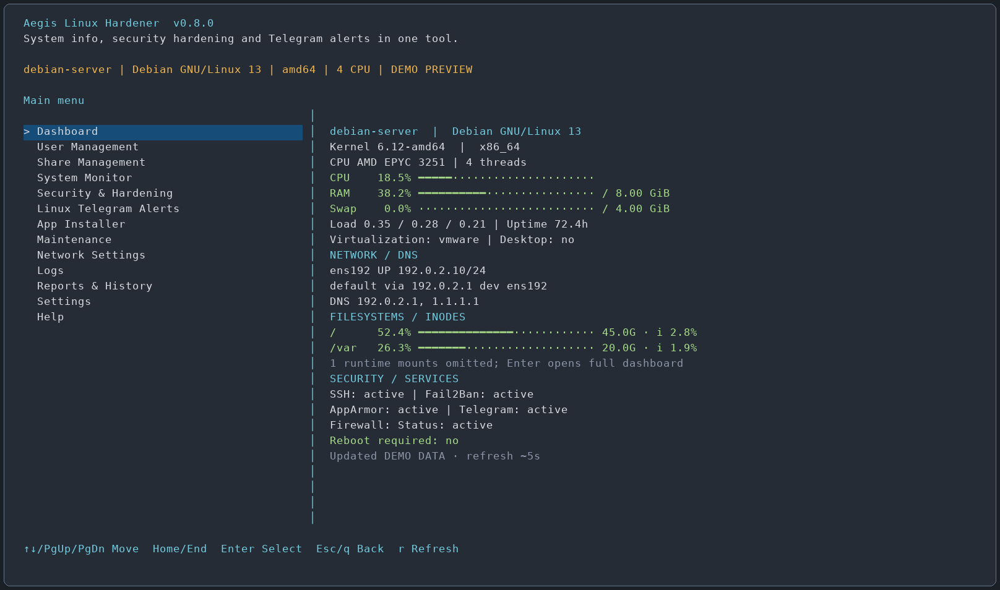
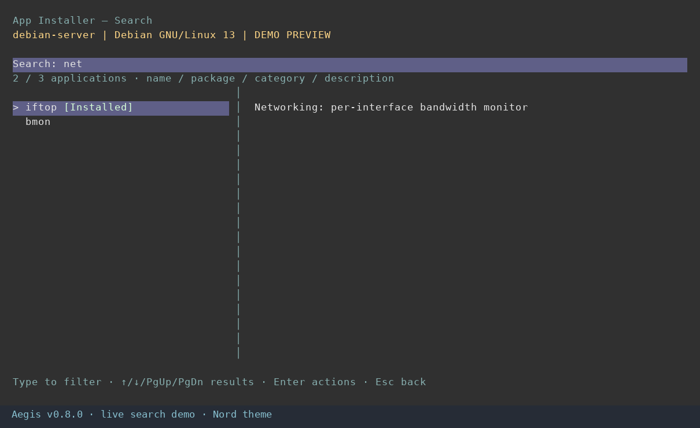
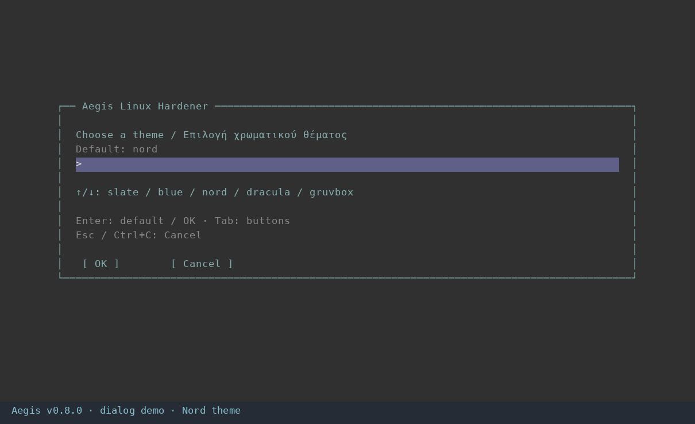
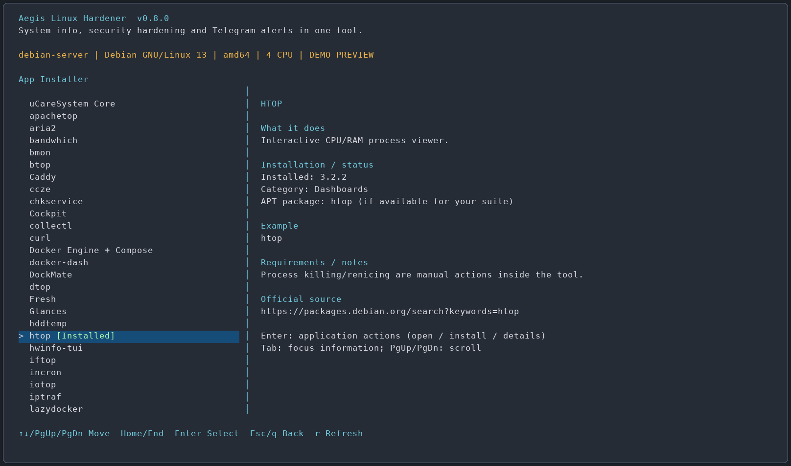

# Aegis Linux Hardener

> System info, security hardening and Telegram alerts in one tool.

**Έκδοση 0.8.0 — πρώτη έκδοση για έλεγχο, με κύρια χρήση σε servers και υποστήριξη desktops σε Debian-based Linux.**

[English documentation](README.md)



Το δείγμα παράγεται από τον κώδικα σχεδίασης του μενού με ενδεικτικά στοιχεία μηχανήματος. Δεν παρουσιάζει εγκατάσταση σε παραγωγικό server.

## Νέα στην 0.8.0 — ζωντανή αναζήτηση και διαχείριση λίστας εφαρμογών



### Search πρώτο στη λίστα

**App Installer — categories → Search applications** είναι η πρώτη επιλογή. Πατάς Enter και αρχίζεις να γράφεις. Τα αποτελέσματα αλλάζουν **σε κάθε πλήκτρο**, χωρίς δεύτερο Enter. Η αναζήτηση καλύπτει όνομα, πακέτο, κατηγορία και περιγραφικές πληροφορίες. Δεν ξεχωρίζει κεφαλαία/πεζά και, αν γράψεις πολλές λέξεις, πρέπει να ταιριάζουν όλες. Με κενό πεδίο εμφανίζεται όλος ο ορατός κατάλογος.

- ↑/↓ και Page Up/Page Down: μετακίνηση στα αποτελέσματα. Δεξιά εμφανίζονται πληροφορίες όταν υπάρχει αρκετό πλάτος.
- Enter: ανοίγει τις ενέργειες της επιλεγμένης εφαρμογής. Η πληκτρολόγηση δεν εγκαθιστά ούτε εκκινεί πρόγραμμα.
- Backspace/Delete: διόρθωση κειμένου. ←/→ και Home/End: μετακίνηση δρομέα. Ctrl+U: καθαρισμός.
- Esc/Ctrl+C: επιστροφή στις κατηγορίες. Αν δεν βρεθεί αποτέλεσμα, συνεχίζεις να διορθώνεις ή ακυρώνεις.
- Η ένδειξη `όνομα [Installed]` διατηρεί το χρώμα του theme.

Κατάσταση πακέτων και διαθεσιμότητα φορτώνονται μία φορά κατά το άνοιγμα της αναζήτησης. Δεν εκτελείται APT σε κάθε πλήκτρο. Σε basic/dumb terminal χρησιμοποιείται απλό πεδίο αναζήτησης και μετά λίστα αποτελεσμάτων.

### Settings → Manage App Installer list

Οι παρακάτω ενέργειες αλλάζουν **μόνο τη λίστα**, όχι τα εγκατεστημένα προγράμματα:

| Επιλογή | Τι κάνει |
| --- | --- |
| Add APT application | Προσθέτει πακέτο APT με όνομα, περιγραφή, κατηγορία και προαιρετικό εκτελέσιμο |
| Remove entry / hide built-in | Διαγράφει προσαρμοσμένη καταχώριση ή κρύβει ενσωματωμένη εφαρμογή |
| Restore hidden built-in entry | Επαναφέρει υποστηριζόμενη ενσωματωμένη εφαρμογή στη λίστα |
| View catalog configuration | Δείχνει τις αποθηκευμένες προσαρμογές |

Παράδειγμα με `duf`, αν υπάρχει στα repositories της διανομής σου:

1. Settings → Manage App Installer list → Add APT application.
2. Δίνεις πακέτο `duf`, όνομα `duf`, σύντομη περιγραφή και κατηγορία **Dashboards**.
3. Προαιρετικό εκτελέσιμο: `duf`. Κενό σημαίνει προβολή αρχείων/οδηγιών του πακέτου αντί για αυτόματη εκκίνηση.
4. Ελέγχεις το σχέδιο αλλαγής λίστας και πατάς Enter/y.
5. Ανοίγεις App Installer/Search, βρίσκεις το duf και επιλέγεις Install, αν το θέλεις. **Η καταχώριση στη λίστα δεν κάνει εγκατάσταση.** Αν υπάρχει ήδη εγκατεστημένο, εμφανίζεται με `[Installed]`.

Στο πεδίο εκτελέσιμου επιτρέπεται ένα όνομα χωρίς path, ορίσματα ή shell εντολές. Ελέγχεται ότι το εγκατεστημένο πακέτο περιλαμβάνει το εκτελέσιμο στο `/usr/bin` ή `/bin`. Εκτελείται ως ο αρχικός κανονικός χρήστης, χωρίς επιλογή root launcher. Δεν εισάγονται αυθαίρετα scripts/URLs GitHub ή νέα repositories. Στις προσαρμοσμένες εγκαταστάσεις αποτρέπεται η αυτόματη εκκίνηση υπηρεσιών όσο εκτελείται το APT· package scripts και scheduled jobs εξακολουθούν να ακολουθούν τη συμπεριφορά του πακέτου. Για Docker/NetworkManager χρησιμοποιούνται τα ενσωματωμένα προφίλ.

Οι νέες εφαρμογές υποστηρίζουν Installed, Install και το υπάρχον ελεγχόμενο APT Uninstall. Το uninstall κρατά ρυθμίσεις/δεδομένα και ελέγχει dependencies/προστατευμένα πακέτα. Η επαναφορά πακέτων εξακολουθεί να εξαρτάται από τη διαθεσιμότητα παλιών `.deb`. Προσαρμοσμένες εφαρμογές στις κατηγορίες **Dashboards** και **System & hardware** εμφανίζονται επίσης στο System Monitor → Monitoring applications.

Οι ρυθμίσεις αποθηκεύονται στο `/etc/aegis-linux-hardener/app-catalog.json`, έξω από τον φάκελο του προγράμματος, και διατηρούνται στις αναβαθμίσεις. Κάθε αλλαγή κρατά backup. Από **Reports & History → Undo actions / backups** επαναφέρεις προηγούμενη λίστα χωρίς εγκατάσταση/απεγκατάσταση προγραμμάτων ως παρενέργεια. Αν αφαιρέσεις προσαρμοσμένη καταχώριση, το εγκατεστημένο πακέτο μένει· πρόσθεσέ το ξανά για διαχείριση μέσα από το Aegis.

### Αφαίρεση Guide only

PNANA, psnet και watcher δεν εμφανίζονται πλέον στον κατάλογο. Φιλτράρονται και τυχόν άλλες καταχωρίσεις με χαρακτηρισμό **Guide only**. Η προεπιλεγμένη ορατή λίστα έχει **56 ενσωματωμένες εφαρμογές**, πριν από προσωπικές προσθήκες/αποκρύψεις. Οι **Unavailable** καταχωρίσεις APT διατηρούνται, επειδή μπορεί να γίνουν διαθέσιμες μετά από αλλαγή repositories/metadata. Δεν διαγράφεται τυχόν εγκατεστημένο αντίγραφο των εφαρμογών που αφαιρέθηκαν από τη λίστα.

Έλεγχοι: **250 αυτοματοποιημένες δοκιμές**, οι προηγούμενοι **9 έλεγχοι διαλόγων**, **4 μεταβάσεις με καθυστερημένη είσοδο** από dashboard και πραγματικός έλεγχος ζωντανής αναζήτησης με μηδενικά αποτελέσματα, διόρθωση, επιλογή και ακύρωση. Δεν έγιναν εγκαταστάσεις/απεγκαταστάσεις, αλλαγές στις δικές σου ρυθμίσεις ή δημοσίευση στο site.

## Διόρθωση 0.7.1 — τα παράθυρα έκλειναν με «no input»

Το live dashboard χρησιμοποιούσε χρονικό όριο εισόδου 200 ms. Το curses διατηρούσε αυτή τη ρύθμιση στο επόμενο παράθυρο, οπότε η αναμονή για πληκτρολόγηση έληγε και εμφανιζόταν «no input». Το πρόβλημα αναπαράχθηκε πριν τη διόρθωση. Πλέον κάθε οθόνη ορίζει τη δική της αναμονή: περιοδική στο live dashboard, απεριόριστη στα απλά μενού, στις προβολές και στις ερωτήσεις.

Προστέθηκε πραγματικός έλεγχος PTY με μετάβαση από dashboard σε υπομενού, ερώτηση, προβολή και ακύρωση ερώτησης, με αναμονή 800 ms πριν από κάθε απάντηση. Πέρασαν και οι τέσσερις μεταβάσεις, οι προηγούμενοι εννέα έλεγχοι διαλόγων και οι 226 αυτοματοποιημένες δοκιμές.

Εγκατάσταση διορθωμένης έκδοσης: `sudo bash ./install-aegis.sh --install`. Μέχρι την ενημέρωση, προσωρινή παράκαμψη: `sudo env AEGIS_DIALOGS=0 aegis`. Δεν απαιτείται επαναφορά ρυθμίσεων λειτουργικού.

## Νέα στην 0.7.0 — online update, SSH keys και παράθυρα ερωτήσεων



### Ενημέρωση από το karanik.gr, βήμα προς βήμα

Στο **Settings → Check / install update** εμφανίζεται η τρέχουσα και η διαθέσιμη έκδοση. Επιβεβαιώνεις λήψη και εγκατάσταση με Enter/y. Το Esc/Cancel επιστρέφει. Ελέγχονται checksum SHA-256 και ένδειξη έκδοσης πριν εκτελεστεί ο installer. Δεν επιτρέπεται downgrade ή επανεγκατάσταση ίδιας έκδοσης μέσω updater. Για επανεγκατάσταση χρησιμοποιείς απευθείας `install-aegis.sh --install`.

Ο installer αποθηκεύει backup/undo της προηγούμενης εγκατάστασης και κρατά τις υπάρχουσες ρυθμίσεις και το ιστορικό. Μετά από επιτυχή ενημέρωση το Aegis κλείνει. Το ανοίγεις ξανά με `aegis` για να φορτωθεί ο νέος κώδικας.

Ανέβασε **αυτά τα τρία αρχεία από το ίδιο ZIP** στον φάκελο του site που αντιστοιχεί στο `https://karanik.gr/scripts/linux/aegis-linux-hardener/`:

| Αρχείο | Χρήση |
| --- | --- |
| `install-aegis.sh` | Πλήρης installer για αρχική εγκατάσταση και αναβάθμιση |
| `update-aegis.sh` | Προαιρετικό ξεχωριστό σημείο εκκίνησης ενημέρωσης |
| `release.json` | Απαραίτητη έκδοση, URL installer και checksum SHA-256 |

1. Αποσυμπίεσε το ZIP στον υπολογιστή σου.
2. Ανέβασε πρώτα τα δύο `.sh` στον δημόσιο φάκελο του site.
3. Ανέβασε το `release.json` **τελευταίο**. Όλα πρέπει να προέρχονται από την ίδια έκδοση. Μην αλλάξεις τον installer μετά τη δημιουργία του checksum.
4. Τα URLs πρέπει να επιτρέπουν HTTPS λήψη χωρίς login, redirect, browser challenge ή αποκλεισμό WAF. Τα αρχεία προσφέρονται ως στατικά downloads, όχι ως προγράμματα που εκτελεί ο web server.
5. Από τον Linux server έλεγξε: `curl -fS https://karanik.gr/scripts/linux/aegis-linux-hardener/release.json`.
6. Μετά χρησιμοποίησε το μενού ενημέρωσης. HTTP 403 σημαίνει απαγόρευση πρόσβασης, HTTP 404 ανύπαρκτο αρχείο/διαδρομή. Και στις δύο περιπτώσεις δεν εκτελείται installer.

Ανεξάρτητη εντολή ενημέρωσης, αφού δημοσιευτούν τα αρχεία:

```bash
curl -fSLo update-aegis.sh https://karanik.gr/scripts/linux/aegis-linux-hardener/update-aegis.sh && sudo bash ./update-aegis.sh
```

Αρχική εγκατάσταση από το URL:

```bash
curl -fSLo install-aegis.sh https://karanik.gr/scripts/linux/aegis-linux-hardener/install-aegis.sh && sudo bash ./install-aegis.sh --install
```

Το domain αποτελεί έμπιστη πηγή κώδικα. HTTPS και checksum από το **ίδιο site** ελέγχουν ακεραιότητα/ασυμφωνία αρχείων· δεν ισοδυναμούν με ανεξάρτητη ψηφιακή υπογραφή release. Δεν προστίθεται αυτόματη ενημέρωση με cron ή δημόσια θύρα. Το `python3 build_release.py` αναδημιουργεί installer, updater και σωστό manifest όταν αλλάζει ο κώδικας.

### Προβολή και αφαίρεση SSH public keys

**User Management → View / remove SSH public keys → χρήστης → αρχείο**. Βλέπεις τύπο κλειδιού, fingerprint, σχόλιο και αν έχει περιορισμούς. Επιλέγεις κλειδί και μετά View ή Remove. Το View entire file περιλαμβάνει σχόλια και μη αναγνωρισμένες γραμμές, που παραμένουν μόνο για προβολή.

Υποστηρίζονται τα τοπικά `~/.ssh/authorized_keys` και `authorized_keys2`. Προσαρμοσμένα AuthorizedKeysFile, AuthorizedKeysCommand, CA trust και private keys δεν αλλάζουν από αυτό το μενού. Οι διαδρομές με symlink απορρίπτονται.

Η αφαίρεση έχει προεπιλογή **No**, προειδοποιεί για τελευταίο αναγνωρισμένο κλειδί στο αρχείο και κρατά backup με metadata. Αφαιρεί μόνο την επιλεγμένη γραμμή, διατηρώντας άλλα keys/options/σχόλια. Αν το αρχείο αλλάξει μέχρι την εφαρμογή, απαιτεί νέα ανάγνωση. Όταν εκτελείται μέσω SSH, ενεργοποιείται timed rollback και ζητείται επιβεβαίωση από νέα SSH σύνδεση. Κράτα ανοιχτή την τρέχουσα σύνδεση. Η αφαίρεση δεν αποσυνδέει υπάρχουσες συνδέσεις ούτε καταργεί το ίδιο key από άλλα αρχεία. Για επαναφορά: **Reports & History → Undo actions / backups**.

### Χειρισμός των νέων παραθύρων

Πληκτρολογείς στο πεδίο, αλλάζεις διαθέσιμες επιλογές με ↑/↓ και πατάς Enter για προεπιλογή/επιλογή. Με Tab/Shift+Tab πας στα **OK / Cancel** και με ←/→ αλλάζεις κουμπί. Esc/Ctrl+C ακυρώνει και επιστρέφει. Τα μυστικά εμφανίζονται ως αστερίσκοι. Ο οδηγός Telegram που ανοίγει από το Aegis χρησιμοποιεί τα ίδια πλαίσια και το ίδιο theme.

Χρειάζονται τουλάχιστον 32 στήλες × 15 γραμμές. Για παλιό terminal ή troubleshooting: `AEGIS_DIALOGS=0 aegis` ή `sudo env AEGIS_DIALOGS=0 aegis`, ώστε να χρησιμοποιούνται οι προηγούμενες ερωτήσεις μέσα στο terminal. Το αυτόνομο Telegram module παραμένει ανεξάρτητο.

Έλεγχοι έκδοσης: **226 αυτοματοποιημένες δοκιμές** και **9 πραγματικοί PTY έλεγχοι**, μαζί με ακύρωση, απόκρυψη μυστικών, επαναφορά terminal και επιστροφή από οδηγό δικτύου. Πέρασε και ο προηγούμενος έλεγχος live dashboard/Page Down. Η ενημέρωση ελέγχθηκε με προσομοιωμένο δίκτυο/εκτέλεση, χωρίς αλλαγή SSH keys, παραγωγική εγκατάσταση ή upload στο site. Το ζωντανό αίτημα στο release.json επέστρεψε HTTP 403 κατά την προετοιμασία· η δημοσίευση και πρόσβαση χρειάζονται έλεγχο.

## Νέα στην 0.6.0 — χειρισμός, θέματα και κατηγορίες

- Η ένδειξη εμφανίζεται **μετά το όνομα**, π.χ. `iftop [Installed]`, με χρώμα ανάλογα με το theme. Η έκδοση φαίνεται στις πληροφορίες.
- Ο App Installer έχει κατηγορίες και **All apps**. Παραμένουν 59 καταχωρίσεις. Το uCareSystem είναι πρώτο στο All apps. Οι κενές κατηγορίες δείχνουν μηδενικό πλήθος.
- 10 θέματα: `slate`, `blue`, `nord`, `dracula`, `gruvbox`, `solarized`, `forest`, `amber`, `light`, `plain`.
- Στις ερωτήσεις επιλογών: **↑/↓** για επιλογή, πληκτρολόγηση αν προτιμάς, **Enter** για προεπιλογή/επιλογή. Στο ελεύθερο κείμενο, ↑ φορτώνει την προεπιλογή για επεξεργασία.
- **Esc**, **Ctrl+C**, `q` ή `/back` ακυρώνουν την ερώτηση και επιστρέφουν στο προηγούμενο μενού. Στους κωδικούς χρησιμοποιείς Ctrl+C. Στο κεντρικό μενού το Ctrl+C τερματίζει την εφαρμογή. Αν διακοπεί αλλαγή που εκτελείται ήδη, έλεγξε Reports & History και το backup/undo: ενδέχεται κάποια βήματα να έχουν ολοκληρωθεί.
- **Network Settings → Change hostname**: δίνεις νέο όνομα, επιλέγεις αν θα ενημερωθεί το `127.0.1.1` στο hosts και ελέγχεις το σχέδιο πριν Enter/y. Αποθηκεύονται τα διαχειριζόμενα αρχεία και το προηγούμενο runtime hostname για undo. Εξωτερικό DNS, πιστοποιητικά και ονόματα υπηρεσιών δεν μετονομάζονται. Άνοιξε νέο shell για ανανέωση του prompt.

### Γιατί δεν εγκαθιστούσε το netscanner;

Στην προηγούμενη έκδοση δεν υπήρχε κατάλληλο APT candidate ή επαληθευμένο έτοιμο binary για το συγκεκριμένο σύστημα. Η 0.6.0 προσθέτει πραγματικό **Build/install from source**. Επιλέγεις την εφαρμογή, βλέπεις το σχέδιο, πατάς Enter/y και περιμένεις. Χρειάζονται Internet, τουλάχιστον 4 GiB ελεύθερα στο `/var/tmp` και εκτέλεση μέσω sudo από κανονικό χρήστη. Τα απαιτούμενα πακέτα εμφανίζονται πριν την έγκριση. Το build μπορεί να διαρκέσει αρκετά λεπτά.

Τα downloads επαληθεύονται με checksum. Η μεταγλώττιση γίνεται ως κανονικός χρήστης με προσωρινό Rust toolchain, χωρίς αντικατάσταση του Rust του λειτουργικού. Το Cargo χρησιμοποιεί το lockfile. Μετά την επιτυχία το binary τοποθετείται στο `/usr/local/bin/netscanner` με 0755, χωρίς SUID ή πρόσθετα capabilities. Αποθηκεύονται έκδοση και hashes σε receipt. Μετά εμφανίζονται Open και Uninstall.

Ο κατάλογος δηλώνει μέθοδο εγκατάστασης και **Guide only / Unavailable** όπου χρειάζεται. Τέτοιες καταχωρίσεις δείχνουν οδηγίες αντί για κουμπί Install που αποτυγχάνει. Το PNANA παραμένει οδηγός όταν δεν υπάρχει APT πακέτο. Το psnet είναι Windows-only και το watcher χρειάζεται ακριβές upstream project. Η ανανέωση APT μπορεί να ελέγξει ξανά τη διαθεσιμότητα.

Το Uninstall υποστηρίζει συγκεκριμένα APT πακέτα και γνωστά root-owned standalone binaries. Για εξωτερικές/user-managed εγκαταστάσεις μπορεί να απαιτείται ο αρχικός package manager· εμφανίζεται εξήγηση. Το backup καλύπτει διαχειριζόμενα αρχεία/metadata. Το package undo εξαρτάται από τη διαθεσιμότητα προηγούμενων πακέτων και δεν αναιρεί κάθε package script ή εξωτερική επίδραση.

Έλεγχοι: **208 αυτοματοποιημένες δοκιμές**, **7 έλεγχοι πραγματικού PTY** και επιτυχής απομονωμένη μεταγλώττιση netscanner **0.6.43**. Δεν εκτελέστηκαν αλλαγές παραγωγικού hostname/δικτύου/λογαριασμών ή εγκατάσταση πακέτων στο μηχάνημά σου. Η τελική root εγκατάσταση χρειάζεται δοκιμή σε αναλώσιμο Debian/Ubuntu VM με πρόσβαση console. Το Help διαβάζει το README της έκδοσης.

## Νέα στην έκδοση 0.5.0 — χρήστες, shares, DNS και uninstall

Στο Network Settings προστέθηκαν **DNS Settings** και **Edit /etc/hosts**. Στο κεντρικό μενού υπάρχουν **User Management** και **Share Management**. Το System Monitor έχει **Monitoring applications** με 28 εργαλεία από τον ίδιο κατάλογο, ενώ κάθε εγκατεστημένη εφαρμογή έχει επιλογή **Uninstall (keep data/config)**. Προστέθηκε και το Samba στον κατάλογο: **59 καταχωρίσεις**.

### DNS χωρίς αλλαγή IP

1. Network Settings → DNS Settings → Current DNS / resolver για προβολή των σημερινών ρυθμίσεων.
2. Edit DNS only → επιλέγεις interface.
3. Manual DNS για δικές σου IPv4/IPv6 DNS IP ή Automatic όπου το υπάρχον DHCP/resolver το υποστηρίζει.
4. Γράφεις DNS με κενά/κόμματα. Στα search domains το `-` διατηρεί τα υπάρχοντα· κενό τα καθαρίζει.
5. Διαβάζεις το σχέδιο και Enter/y. Τροποποιούνται μόνο DNS επιλογές του υποστηριζόμενου υπάρχοντος Netplan, NetworkManager, ifupdown/resolvconf ή networkd/resolved. Απλό πραγματικά unmanaged resolv.conf έχει fallback επεξεργασίας. Αμφίσημα/εξωτερικά διαχειριζόμενα ή symlink resolver αρχεία απορρίπτονται.
6. Από νέα SSH σύνδεση εκτελείς την εμφανιζόμενη επιβεβαίωση μέσα σε 180 δευτερόλεπτα και ελέγχεις ότι λειτουργεί η επίλυση ονομάτων. Οι δηλωμένες IP/gateway/routes διατηρούνται· το reload/apply μπορεί να επηρεάσει προσωρινά συνδεσιμότητα, ειδικά το Netplan και άλλα links.

Δεν αλλάζει αυτόματα network manager, δεν εγκαθιστά άλλον resolver και δεν απενεργοποιεί IPv6. Το Automatic DNS χρειάζεται υπάρχουσα DHCP DNS πηγή. Σύνθετα/custom configurations χρειάζονται ξεχωριστό έλεγχο.

### Επεξεργασία hosts

Network Settings → Edit /etc/hosts → View/Add/Edit/Delete. Κάθε εγγραφή έχει IPv4/IPv6, hostname/aliases και προαιρετικό σχόλιο. Επιλέγεις συγκεκριμένη γραμμή για αλλαγή/διαγραφή. Οι άλλες εγγραφές και τα σχόλια διατηρούνται. Αν το αρχείο άλλαξε ενδιάμεσα, ζητείται νέα επιλογή. Οι βασικές localhost/loopback/host-identity εγγραφές προστατεύονται. Είναι τοπική αντιστοίχιση ονομάτων, όχι εγγραφή σε εξωτερικό DNS server, και δεν χρειάζεται network restart.

### User Management

Περιλαμβάνει λίστες τοπικών χρηστών/groups, δημιουργία χρήστη, Linux password, lock/unlock password, expiry enable/disable λογαριασμού, επιλογή shell, διαγραφή, συμμετοχές σε groups/sudo, δημιουργία/διαγραφή group, προσθήκη SSH public key, sessions και permissions/ACL.

- Οι συνήθεις λογαριασμοί είναι UID 1000–59999. System/LDAP/domain accounts δεν τροποποιούνται ως κανονικοί χρήστες. Ο τρέχων λογαριασμός διαχείρισης προστατεύεται από διαγραφή/απενεργοποίηση/lock και αφαίρεση της πρόσβασης διαχείρισης.
- Ο νέος χρήστης παίρνει δικό του group και home σύμφωνα με τα defaults της διανομής. Το password παραμένει κλειδωμένο μέχρι να επιλέξεις Set Linux password. Το passwd ζητά τον κωδικό χωρίς να εμφανίζεται σε argv/history.
- Lock password δεν σημαίνει πλήρη απενεργοποίηση: SSH keys και ήδη ενεργές συνεδρίες μπορεί να παραμένουν λειτουργικές. Το account expiry αφορά επόμενα logins σύμφωνα με PAM/SSH, όχι αυτόματο kill συνεδριών.
- Προσθήκη/αφαίρεση supplementary group διατηρεί τα άλλα groups. sudo/docker παρέχουν ισχυρά δικαιώματα. Μπορεί να χρειαστεί νέο login.
- Διαγραφή χρήστη απορρίπτεται αν έχει ενεργά processes και δεν χρησιμοποιεί userdel -r. Home/mail/shared αρχεία παραμένουν. Το undo δημιουργίας λογαριασμού δεν διαγράφει αναδρομικά δεδομένα και μπορεί να αφήσει αρχεία με orphan UID.
- Προσθήκη SSH key δέχεται μόνο υποστηριζόμενο public key και διατηρεί τα προηγούμενα keys. Μην επικολλήσεις private key. Δοκίμασε νέα SSH σύνδεση πριν αλλάξεις πολιτική authentication.

Τα snapshots χρηστών περιέχουν μόνο τις επιλεγμένες εγγραφές, hashes και subordinate UID/GID ranges. Το undo ελέγχει το καταγεγραμμένο post-change state, προστατεύει άσχετους νεότερους χρήστες/groups και αρνείται conflicts ή επαναχρησιμοποίηση UID/GID. Επαναφέρεις πρώτα τις νεότερες αλλαγές. Χρησιμοποιούνται locks λογαριασμών. Τα root-only snapshots περιέχουν ευαίσθητα hashes, όχι κρυπτογραφημένα backup archives: δεν τα ανεβάζεις στο GitHub.

### Permissions / POSIX ACL

Από User Management ή Share Management:

1. Γράφεις ένα υπάρχον κανονικό αρχείο/φάκελο κάτω από /home, /srv, /mnt, /media ή /opt. Symlink και system-root paths αποκλείονται.
2. Inspect δείχνει owner/group, octal mode και getfacl.
3. Επιλέγεις chmod (π.χ. 0750/2770), owner/group ή ACL για συγκεκριμένο user/group.
4. Default ACL επιλέγεται ρητά για φάκελο και αφορά νέα παιδιά, όχι όλα τα υπάρχοντα περιεχόμενα.
5. Προεπισκόπηση και εφαρμογή. Η αλλαγή είναι **μη αναδρομική**, μόνο στο συγκεκριμένο αντικείμενο. Αποθηκεύονται mode, UID/GID και ακριβές POSIX ACL/mask/default ACL για undo.

Αν λείπει acl, προτείνεται εγκατάσταση εκεί. Το effective ACL mask επηρεάζει τα τελικά δικαιώματα και το setfacl μπορεί να το επανυπολογίσει. Αν το αντικείμενο αντικαταστάθηκε με άλλο inode, δεν εφαρμόζονται στα τυφλά παλιά metadata/ACL. Δεν υλοποιείται Windows NT/SID ACL editor ή αυθαίρετο recursive permission repair.

### Share Management / Samba

Η ενότητα διαχειρίζεται **standalone Samba με τοπικό tdbsam**, όχι Active Directory/domain-member server.

- Install Samba εγκαθιστά samba/smbclient/acl και κρατά τις νέες υπηρεσίες stopped/disabled. Τα υπάρχοντα configs διατηρούνται.
- List shares εμφανίζει και υπάρχοντα εξωτερικά shares ως read-only inventory. Connected clients/open files χρησιμοποιεί smbstatus χωρίς να αποσυνδέει πελάτες.
- Create/edit/remove διαχειρίζεται μόνο το include αρχείο του Aegis. Δεν ξαναγράφει αυθαίρετα external shares. Η διαγραφή share αφαιρεί μόνο τη ρύθμιση, όχι τα δεδομένα του φακέλου.
- Νέα shares έχουν guest=no, συγκεκριμένους Linux users/@groups και ρητά trusted client IP/subnets. Το SMB write access είναι ξεχωριστό από Unix write/traverse/ACL. Δεν προστίθεται SMB1, δημόσιο firewall opening ή αυτόματο start.
- Samba password είναι διαφορετικό από Linux password. Υπάρχουν Add/reset και enable/disable SMB account. Η επαναφορά καλύπτει βασικό credential/password/flags, όχι πλήρες SAM/SID/domain state.
- Το testparm ελέγχει τη σύνταξη πριν εφαρμογή. Αν smbd τρέχει, ζητείται reload. Παλιοί clients μπορεί να κρατούν τις παλιές ρυθμίσεις μέχρι reconnect. Το validation δεν εγγυάται σωστά filesystem/client δικαιώματα.
- Service control έχει ανεξάρτητο start/stop και enable/disable στο boot. Το start χρησιμοποιεί το υπάρχον bind/interface policy: έλεγξε LAN/VPN/firewall πριν ενεργοποίηση. Δεν ανοίγονται αυτόματα public SMB ports.
- SMB client / mounted shares εγκαθιστά cifs-utils/smbclient και δείχνει CIFS mounts. Μόνιμο remote mount και credential file παραμένουν ξεχωριστή χειροκίνητη ρύθμιση με έλεγχο.

### Παράδειγμα ιδιωτικού team share

1. User Management → Create group → `team`.
2. Create local user → π.χ. `alice`. Πρόσθεσέ την στο group team από Group membership.
3. Share Management → Create shared data folder → `/srv/team`, group team. Δημιουργείται κενός root:team φάκελος 2770 με setgid.
4. Samba accounts → Add/reset SMB password → alice. Ανεξάρτητο από Linux password.
5. Create share → name `team`, path `/srv/team`, valid users `@team`, trusted clients το πραγματικό LAN/VPN subnet σου. Δώσε SMB write μόνο αν χρειάζεται.
6. Δες το validated σχέδιο και ξεκίνα ρητά smbd. Προαιρετικά enable-at-boot ξεχωριστά. Έλεγξε scoped TCP 445 πρόσβαση από Security → Firewall Manager· δεν δημιουργείται αυτόματα κανόνας.
7. Από Windows στο επιτρεπόμενο δίκτυο άνοιξε `\\SERVER_IP\team` και συνδέσου ως alice.

Αν χρειάζεται επιπλέον πρόσβαση/κληρονομικότητα, χρησιμοποίησε POSIX ACL/default ACL. Το undo νέου φακέλου χρησιμοποιεί μόνο rmdir: αν έχει δεδομένα, διατηρούνται και η επαναφορά επισημαίνεται ως incomplete· ποτέ recursive διαγραφή.

### Εργαλεία και από το System Monitor

System Monitor → Monitoring applications δείχνει 28 σχετικά εργαλεία από τον ίδιο κατάλογο. Όσα υπάρχουν έχουν [Installed], όσα λείπουν [install + open]. Επιλέγεις, δέχεσαι το σχέδιο εγκατάστασης και μετά ανοίγει το εργαλείο. Capture εργαλεία ζητούν interface, Apachetop/Termshark υπάρχον log/PCAP. Αν δεν υπάρχει συμβατό πακέτο/binary, εξηγείται ο περιορισμός. Η εγκατάσταση/απεγκατάσταση παραμένει διαθέσιμη και στο App Installer.

### Uninstall κάθε εφαρμογής

App Installer → εγκατεστημένη εφαρμογή → **Uninstall (keep data/config)** → διαβάζεις ακριβή πακέτα/paths → Enter/y.

Πριν από APT remove γίνεται simulation. Δεν χρησιμοποιείται purge ή autoremove. Αν αφαιρούνται προστατευμένα system/SSH/Python πακέτα ή άσχετες εφαρμογές, η ενέργεια απορρίπτεται. Ενεργό NetworkManager, τρέχοντα Docker workloads και ενεργές Samba υπηρεσίες προστατεύονται. Docker volumes/images, κοινόχρηστα δεδομένα, home και app data διατηρούνται.

Root-owned κανονικά executables στο /usr/local/bin γίνονται backup και αφαιρούνται. Το ίδιο και γνωστά Aegis Python environments. Άλλα external/user-managed installs εξηγούν ότι πρέπει να χρησιμοποιηθεί ο αρχικός installer. Το undo πακέτων απαιτεί ακριβείς παλιές εκδόσεις/ασφαλείς εξαρτήσεις· γίνεται προσπάθεια αποθήκευσης παλιών .deb πριν την αφαίρεση.

### Τι καλύπτει το Undo

| Αλλαγή | Backup/επαναφορά | Όριο |
| --- | --- | --- |
| DNS / hosts | Αρχεία και resolver reload· DNS με timed confirmation | Δεν είναι πλήρες network snapshot. |
| Users / groups / passwords | Επιλεγμένες εγγραφές/hashes/subordinate IDs με conflict checks | Τα δεδομένα/sessions δεν γυρίζουν πίσω· νεότερα conflicts θέλουν πρώτα αναίρεση. |
| Owner / mode / POSIX ACL | Δικαιώματα/ACL ενός αντικειμένου | Όχι recursive tree snapshot· αντικατάσταση inode απορρίπτεται. |
| Samba shares | Config/include και reload | Clients ίσως χρειάζονται reconnect· τα αρχεία shares δεν επαναφέρονται. |
| SMB password/flags | Προστατευμένη επιλεγμένη credential εγγραφή | Όχι όλα τα SAM/SID/domain/login metadata. |
| Νέος κοινόχρηστος φάκελος | rmdir μόνο όταν είναι άδειος | Μη κενά δεδομένα διατηρούνται και αναφέρεται incomplete. |
| Uninstall εφαρμογής | Γνωστά files/config/env και package inventory | Vendor hooks/μη διαθέσιμες παλιές εκδόσεις απαιτούν system/VM snapshot για πλήρη επαναφορά. |

Read-only προβολές δεν χρειάζονται undo. Επεξεργασίες/διαγραφές που κάνεις μέσα σε εξωτερικά εργαλεία και ήδη παραδομένα Telegram αρχεία δεν αναιρούνται. Οι νέες αλλαγές λογαριασμών/ACL κρατούν durable recovery runner και για portable χρήση. Κάθε αλλαγή επιλέγεται/ελέγχεται χωριστά.

## Νέα στην έκδοση 0.4.1 — εγκατάσταση απαιτούμενου εργαλείου επί τόπου

Όταν επιλέγεις μια ενέργεια, ελέγχονται πρώτα οι γνωστές εξαρτήσεις της. Αν λείπει εργαλείο/πακέτο, εμφανίζεται αμέσως σχέδιο εγκατάστασης. Με **Enter ή y** εγκαθίσταται, κρατείται το κανονικό backup, ελέγχεται ξανά η διαθεσιμότητα και συνεχίζεται η αρχική ενέργεια μία φορά. Με **n** η αρχική ενέργεια δεν εκτελείται. Αν αποτύχει η εγκατάσταση ή το εργαλείο παραμένει μη διαθέσιμο, σταματά η συγκεκριμένη ενέργεια χωρίς ατελείωτες επαναλήψεις.

Παράδειγμα: Security & Hardening → Lynis controls → Audit identity / SSH changes. Αν λείπει auditctl/augenrules, προσφέρεται εκεί εγκατάσταση auditd και μετά συνεχίζεται το σχέδιο audit watches. Αντίστοιχα στο Password quality προσφέρεται libpam-pwquality πριν την ερώτηση μήκους. Το q ακυρώνει καθαρά αυτή την ερώτηση. Η εγκατάσταση και η μετέπειτα πολιτική ασφαλείας είναι χωριστές αλλαγές με δική τους προεπισκόπηση/backup.

Καλύπτονται auditd, password quality, AIDE, accounting/sysstat/plocate, rsyslog/TLS, συνήθη security diagnostics, AppArmor tools, Fail2Ban, UFW, Lynis, network helpers και άνοιγμα επιλεγμένων εργαλείων. Το Logs προτείνει άμεσα ccze αν λείπει· με n παραμένουν τα απλά logs. Τα btop/ncdu από System Monitor μπορούν να εγκατασταθούν και να ανοίξουν χωρίς μετάβαση σε άλλο μενού.

Η εγκατάσταση πακέτου δεν σημαίνει ότι είναι διαθέσιμη μια δυνατότητα kernel, αρχικοποιημένη βάση ή ενεργή υπηρεσία. Οι έλεγχοι παραμένουν: nmtui χρειάζεται ενεργό NetworkManager, AIDE έμπιστη baseline και τα ασύμβατα PAM overrides δεν αντικαθίστανται σιωπηρά. Οι ενέργειες Apache προϋποθέτουν υπάρχον web server. Άγνωστες εξαρτήσεις δεν επινοούνται. Τα noninteractive CLI calls δεν ξεκινούν αυτόματα εγκαταστάσεις.

## Νέα στην έκδοση 0.4.0

- Οι εγκατεστημένες εφαρμογές εμφανίζουν **[Installed]** και την εντοπισμένη έκδοση στις πληροφορίες. Η ένδειξη ανανεώνεται μετά την εγκατάσταση, και στο Network Settings/nmtui.
- Με Enter ανοίγει μενού ενεργειών: **Install** όταν λείπει η εφαρμογή, **Open / usage instructions** όταν υπάρχει, πληροφορίες και ανανέωση.
- Προστέθηκε το **ccze**: συνολικά **58 καταχωρίσεις** εφαρμογών.
- Νέα κεντρική κατηγορία **Logs**, με κατηγορίες, χρώμα `ccze -A`, export και αποστολή αρχείου στο Telegram.
- **Fail2Ban Manager / Firewall Manager** βρίσκονται πλέον μέσα στο **Security & Hardening**.
- **Help τελευταίο στο κεντρικό μενού**, με το πραγματικό README του πακέτου, ολόκληρο ή ανά ενότητα.

## Πρώτη χρήση — αναλυτικά βήματα

### 1. Τι χρειάζεται

Debian/Ubuntu-based μηχάνημα, λογαριασμός SSH με sudo και Python 3.9+. Κυρίως προορίζεται για servers. Εφαρμογές με γραφικό περιβάλλον χρειάζονται desktop. Η πρώτη δοκιμή αλλαγών ασφαλείας/δικτύου πρέπει να γίνει σε VM με console πρόσβαση.

Όπου βλέπεις `SERVER_IP`, γράφεις τη δική σου IP Linux. Όπου βλέπεις `karanik`, αντικαθιστάς με τον δικό σου χρήστη, αν διαφέρει. Δεν αντιγράφεις κυριολεκτικά το SERVER_IP.

### 2. Κατέβασμα και μεταφορά από Windows

Κατέβασε το `aegis-linux-hardener-v0.8.0.zip` στα Downloads. Άνοιξε **PowerShell στον υπολογιστή Windows**:

```powershell
scp "$env:USERPROFILE\Downloads\aegis-linux-hardener-v0.8.0.zip" karanik@SERVER_IP:~/
```

Το scp αντιγράφει το ZIP στο home του Linux χρήστη. Δεν κάνει εγκατάσταση. Αν χρησιμοποιείς άλλη θύρα SSH, βάλε `scp -P Η_ΘΥΡΑ ...` με κεφαλαίο P.

### 3. Σύνδεση, αποσυμπίεση και εγκατάσταση

```powershell
ssh karanik@SERVER_IP
```

Οι παρακάτω εντολές εκτελούνται **στο Linux terminal**, αφού συνδεθείς:

```bash
cd ~
unzip -o aegis-linux-hardener-v0.8.0.zip
cd ~/aegis-linux-hardener
sudo bash ./install-aegis.sh --install
```

Αν λείπει το unzip ή βασικά εργαλεία:

```bash
sudo apt update
sudo apt install unzip python3 ca-certificates curl
```

Το sudo μπορεί να ζητήσει τον Linux κωδικό σου. Καθώς γράφεις, συνήθως δεν εμφανίζονται χαρακτήρες. Διάβασε τη σύνοψη και πάτησε **Enter ή y** για εγκατάσταση, **n** για ακύρωση. Εγκαθίσταται το πρόγραμμα/launcher. Οι επιπλέον ενέργειες επιλέγονται από τα μενού.

### 4. Άνοιγμα αργότερα / portable

```bash
aegis
# Προαιρετικά όλο το μενού με δικαιώματα root:
sudo aegis
```

Από τον αποσυμπιεσμένο φάκελο, χωρίς εγκατάσταση του προγράμματος:

```bash
bash ./install-aegis.sh --portable
```

Χωρίς παραμέτρους επιλέγεις Install/Update ή Portable. Με `--install --no-launch` γίνεται εγκατάσταση χωρίς να ανοίξει το μενού. Το `--check` ελέγχει ακεραιότητα/syntax χωρίς εγκατάσταση.

### 5. Πού βρίσκεται κάθε λειτουργία

| Κεντρική επιλογή | Τι κάνεις εκεί |
| --- | --- |
| Dashboard | Πληροφορίες OS/kernel/CPU/RAM/δίσκων/δικτύου/υπηρεσιών. Η σύνοψη εμφανίζεται δεξιά χωρίς Enter. |
| System Monitor | Top CPU/RAM διεργασίες, θύρες, συνδέσεις, υπηρεσίες και containers. |
| Security & Hardening | Επιλεκτικές ενέργειες ασφάλειας. Εδώ βρίσκονται Fail2Ban Manager και Firewall Manager. |
| Linux Telegram Alerts | Ρυθμίσεις bot, προορισμού, κατηγοριών ειδοποιήσεων και ορίων. |
| App Installer | Εγκατάσταση εφαρμογής, άνοιγμα εγκατεστημένης εφαρμογής, πληροφορίες. |
| Maintenance | Ενημερώσεις και επιλεγμένες εργασίες συντήρησης με προεπισκόπηση. |
| Network Settings | Στατική IPv4/DHCP με τον υπάρχοντα manager ή προστατευμένο nmtui. |
| Logs | Προβολή ανά κατηγορία, export ή αποστολή στιγμιότυπου στο Telegram. |
| Reports & History | Αναφορές συστήματος και Undo προηγούμενης αλλαγής. |
| Settings | Γλώσσα, χρώματα, έκδοση και αφαίρεση προγράμματος. |
| Help | Όλες αυτές οι οδηγίες μέσα στο πρόγραμμα. |

Βελάκια: μετακίνηση. Enter: άνοιγμα. q/Esc: πίσω. Page Up/Down: ανά σελίδα. Home/End: αρχή/τέλος. **Tab**: εστίαση στο δεξί πλαίσιο για κύλιση με βελάκια/Page Up/Down, Tab ξανά για το αριστερό μενού. Το sidebar χρειάζεται terminal πλάτους τουλάχιστον 100 χαρακτήρων. `r` για ανανέωση. Τα εξωτερικά εργαλεία έχουν δικά τους πλήκτρα.

### 6. Παράδειγμα εγκατάστασης και ανοίγματος htop

App Installer → **htop** → **Install application** → διαβάζεις το σχέδιο → Enter/y. Επιστρέφοντας εμφανίζεται **[Installed]**, με έκδοση στις πληροφορίες. Επιλέγεις ξανά htop → **Open / usage instructions**. Με q/F10 μέσα στο htop επιστρέφεις.

Το nmtui εντοπίζεται από το πακέτο `network-manager`, το iptraf από `iptraf-ng`, το Fresh από `fresh-editor`. Αν εγκατέστησες κάτι εκτός Aegis, χρησιμοποίησε Refresh. Το «εγκατεστημένο» είναι διαφορετικό από «ενεργή υπηρεσία».

Τα εργαλεία χρήστη ανοίγουν με τον αρχικό κανονικό χρήστη, ακόμη και όταν το Aegis εκτελείται με sudo. Επιλεγμένα εργαλεία διαχείρισης/capture χρειάζονται root. Στα capture εργαλεία επιλέγεις interface· το tcpdump περιορίζεται σε 100 πακέτα. Το termshark ανοίγει υπάρχον PCAP. Webmin/Cockpit εμφανίζουν οδηγίες browser/SSH tunnel, WinBoat χρειάζεται desktop, uCareSystem εκτελείται από Maintenance, nmtui από Network Settings. ngrok/tmate ανοίγουν help χωρίς αυτόματη δημιουργία tunnel/shared session.

Αλλαγές που κάνεις αργότερα μέσα σε mc/editors/chkservice/rcconf ακολουθούν τη συμπεριφορά της εξωτερικής εφαρμογής. Το installation Undo δεν αναιρεί κάθε μελλοντική αλλαγή αρχείων ή υπηρεσιών μέσα από αυτές.

### 7. Προβολή έγχρωμων logs

Άνοιξε **Logs → ccze → Install colorizer** αν λείπει. Όταν υπάρχει, χρησιμοποιείται αυτόματα **`ccze -A -o nolookups`**. Το `-A` είναι λατινικό κεφαλαίο A και βγάζει ANSI χρώματα. Το nolookups αποφεύγει καθυστερήσεις αναζητήσεων. Αν λείπει, υπάρχει απλό κείμενο και επιλογή εγκατάστασης.

Επίλεξε κατηγορία → **View logs**. Στον pager less: q επιστρέφει, βελάκια/Page Up/Down κυλούν, αριστερά/δεξιά μετακινούν οριζόντια τις μεγάλες γραμμές. Είναι στιγμιότυπο, όχι συνεχές live follow. Με **Refresh snapshot** παίρνεις νέα γεγονότα.

Κατηγορίες: Σύστημα/journal, Authentication/SSH/sudo, Kernel/hardware, Fail2Ban, Firewall/UFW, APT/dpkg, Apache, Nginx, Caddy, Docker engine, επιλεγμένο Docker container, Telegram alerts, security daemons, επιλεγμένη systemd υπηρεσία και επιλεγμένο αρχείο μέσα στο `/var/log`.

Από **Time window / line limit** επιλέγεις τρέχον boot, τελευταία ώρα, σήμερα, τελευταίο 24ωρο ή 7ήμερο και 100/200/500/1000/5000 γραμμές ανά πηγή. Τα κανονικά αρχεία χρησιμοποιούν τελευταίες γραμμές, όχι φίλτρο ημερομηνίας journal. Στα containers σήμερα/boot σημαίνει τελευταίο 24ωρο. Το κείμενο περιορίζεται περίπου σε 2 MiB συν κεφαλίδες. Αν λείπει πηγή log, εμφανίζεται εξήγηση.

### 8. Export αρχείου log

Κατηγορία → **Export snapshot** → δέχεσαι ή αλλάζεις την απόλυτη διαδρομή → Enter/y. Προεπιλογή: αρχείο `.log` με ημερομηνία στο home του αρχικού χρήστη. Το αρχείο έχει καθαρό UTF-8 χωρίς ANSI χρώματα, permissions 0600 και ιδιοκτήτη τον χρήστη ώστε να μπορείς να το αντιγράψεις με scp.

Σε overwrite γίνεται επιβεβαίωση και backup του προηγούμενου αρχείου. Επιτρέπονται διαδρομές στο επιλεγμένο home ή στον φάκελο exports του Aegis. Τα αρχικά logs δεν αλλάζουν.

### 9. Αποστολή στο Telegram

Πρώτα **Linux Telegram Alerts → Install / reconfigure**: γλώσσα, όνομα server, Bot Token, Chat/Channel ID και κατηγορίες. Το bot πρέπει να έχει δικαίωμα αποστολής στον προορισμό. **Topic/thread ID = 0** σημαίνει χωρίς topic. Για συγκεκριμένο forum topic βάζεις το δικό του ID.

Μετά **Logs → κατηγορία → Send snapshot to Telegram**. Βλέπεις το ακριβές στιγμιότυπο, πατάς q για επιστροφή, ελέγχεις Chat ID/Topic και γράφεις **y** για αποστολή. Σε αυτή την εξωτερική αποστολή το σκέτο Enter ακυρώνει. Αποστέλλεται ως **συνημμένο αρχείο .log** με το ήδη ρυθμισμένο bot, χωρίς να εμφανίζεται το token. Χρησιμοποιείται το Telegram Bot API sendDocument.

Προβολή/export/send χρησιμοποιούν το ίδιο στιγμιότυπο μέχρι να επιλέξεις Refresh. Αποκρύπτονται γνωστά μοτίβα bot token, password/API key και authorization headers, με **best-effort** κανόνες. Δεν εντοπίζεται εγγυημένα κάθε μυστικό: διάβασε το αρχείο πριν το μοιραστείς. Η αποστολή αρχείου είναι άμεση και χωριστή από την ουρά του alert collector. Δεν γίνεται αυτόματο retry. Αν υπάρξει αβέβαιο timeout, έλεγξε Telegram πριν ξαναστείλεις. Το Undo δεν ανακαλεί παραδομένο αρχείο Telegram.

### 10. Γιατί το nmtui είναι installed αλλά δεν ανοίγει;

Σε server με ifupdown μπορεί να έχει εγκατασταθεί το nmtui, ενώ το NetworkManager παραμένει ανενεργό. **Installed δεν σημαίνει ότι διαχειρίζεται το υπάρχον interface.** Το Aegis δεν αλλάζει σιωπηρά manager ούτε αφαιρεί `/etc/network/interfaces`. Χρησιμοποίησε τον υπάρχοντα wizard Aegis για τον υποστηριζόμενο backend. Το Open nmtui εξηγεί την προϋπόθεση ενεργού NetworkManager.

Στον wizard Aegis κρατάς την αρχική σύνδεση, συνδέεσαι στη νέα IP από ανεξάρτητη σύνδεση και εκτελείς την εμφανιζόμενη επιβεβαίωση πριν τον timer 180 δευτερολέπτων. Το native nmtui έχει δικό του checkpoint/επιβεβαίωση 150 δευτερολέπτων. Δες τις λεπτομέρειες δικτύου παρακάτω.

### 11. Αναβάθμιση και Undo

Μετέφερε το νέο ZIP, αποσυμπίεσε με `unzip -o` και εκτέλεσε τον νέο installer με `--install`. Για αναίρεση: **Reports & History → Undo actions / backups** → επιλέγεις την αλλαγή από ID/τίτλο. Διάβασε τους περιορισμούς επαναφοράς πακέτων παρακάτω. Πλήρης εγγύηση επαναφοράς μηχανήματος απαιτεί system/VM snapshot.

### 12. Ανέβασμα στο GitHub

Δημιούργησε repository στο GitHub και ανέβασε **τα περιεχόμενα** του αποσυμπιεσμένου φακέλου `aegis-linux-hardener`: `aegis.py`, φάκελο `aegis/`, tests, docs, README, build script και installer. Κράτησε τη δομή μαζί· μόνο το aegis.py δεν περιλαμβάνει modules/Help. Προαιρετικά πρόσθεσε το ZIP ως Release asset. Επίλεξε LICENSE πριν το παρουσιάσεις ως αδειοδοτημένο open-source έργο.

Για το karanik.gr ανεβάζεις **install-aegis.sh, update-aegis.sh και release.json από την ίδια έκδοση**, σύμφωνα με τα βήματα online update στην αρχή. Το πακέτο ετοιμάστηκε τοπικά· δεν έγινε δημοσίευση repository ή upload στον server. Μην ανεβάσεις πραγματικά tokens, client configs, backups ή exports logs στο GitHub.

## Περιεχόμενο

| Μενού | Δυνατότητες |
| --- | --- |
| Dashboard | Λειτουργικό, kernel, αρχιτεκτονική, CPU/RAM/swap, uptime, δίσκοι, IP/DNS, υπηρεσίες και ασφάλεια |
| System Monitor | Top RAM/CPU διεργασίες με δειγματοληψία, θύρες, συνδέσεις, failed services, Docker, btop/ncdu |
| Security & Hardening | Έλεγχος ασφάλειας, Lynis, επιλεκτικές αλλαγές SSH, sysctl, AppArmor, unattended upgrades |
| Security → Fail2Ban Manager | Εγκατάσταση, επιλογή jails, whitelist, όρια, ban/unban |
| Security → Firewall Manager | Προβολή UFW/nftables, εγκατάσταση UFW, κανόνες από συγκεκριμένη πηγή, προστατευμένη ενεργοποίηση |
| Linux Telegram Alerts | Το υπάρχον module με 22 κατηγορίες, γλώσσες, retry queue και ημερήσια αναφορά |
| App Installer | Πρώτο το ucaresystem-core, μετά btop, ncdu, Lynis, Docker, Caddy, Webmin, WinBoat, Cockpit |
| Maintenance | Προβολή/εφαρμογή ενημερώσεων, cache cleanup, χωριστή εκτέλεση uCareSystem |
| Reports & History | Εξαγωγή αναφοράς JSON, ιστορικό ενεργειών και επαναφορά αρχείων |
| Settings | Γλώσσα, χρωματικό θέμα, πληροφορίες και αφαίρεση Aegis |

Η κύρια πλοήγηση και τα prompts υποστηρίζουν επιλογή English/Ελληνικά. Οι τεχνικές εντολές και οι αναλυτικές προεπισκοπήσεις αλλαγών παραμένουν στα αγγλικά. Η γλώσσα του Telegram ρυθμίζεται ανεξάρτητα.

## Απαιτήσεις

- Debian-based Linux με APT/dpkg, `/proc` και ενεργό systemd.
- Python **3.9+** με ssl/sqlite3/fcntl, χωρίς pip dependencies.
- Root/sudo για αλλαγές. Οι σελίδες πληροφοριών λειτουργούν ως απλός χρήστης όπου επιτρέπεται η ανάγνωση.
- `systemd-run` για προστατευμένες αλλαγές SSH/firewall.
- Bash, CA certificates και σύνδεση HTTPS για online λήψεις.

Αρχικοί στόχοι συμβατότητας: Debian 12/13 και Ubuntu 22.04/24.04/26.04. Δεν έχει ολοκληρωθεί δοκιμή σε όλα αυτά τα λειτουργικά. Στα παράγωγα Debian η διαθεσιμότητα εφαρμογών εξαρτάται από τη βάση, την έκδοση και την αρχιτεκτονική. Η προεπιλεγμένη Python 3.8 του Ubuntu 20.04 δεν επαρκεί και το Aegis δεν αντικαθιστά την Python συστήματος.

## Μεταφορά και εγκατάσταση

**1. Από PowerShell στα Windows**, αφού κατεβάσεις το ZIP στα Downloads:

```powershell
# Αντικατάστησε το SERVER_IP με την IP του Linux server.
scp "$env:USERPROFILE\Downloads\aegis-linux-hardener-v0.8.0.zip" karanik@SERVER_IP:~/
```

**2. Από το SSH terminal του Linux:**

```bash
cd ~
unzip -o aegis-linux-hardener-v0.8.0.zip
cd ~/aegis-linux-hardener
sudo bash ./install-aegis.sh --install
```

Αν λείπουν βασικά πακέτα σε Debian/Ubuntu, εγκατέστησέ τα πρώτα ρητά:

```bash
sudo apt update
sudo apt install python3 ca-certificates unzip curl
```

**3. Διάβασε τη σύνοψη και πάτησε **Enter** ή γράψε **y**.** Εγκαθίσταται μόνο το πρόγραμμα και ο launcher. Δεν ενεργοποιείται αυτόματα firewall/hardening/Telegram και δεν εγκαθίστανται εφαρμογές.

Αργότερα ανοίγεις το πρόγραμμα με:

```bash
aegis
```

Το `.sh` είναι αυτοτελές και περιέχει το πρόγραμμα. Αν είσαι ήδη root, παραλείπεις το sudo.

## Προσθήκες v0.3.0

- Η επιλογή **Dashboard** εμφανίζει αμέσως δεξιά πληροφορίες συστήματος, χωρίς Enter. Έγχρωμες μπάρες CPU/RAM/Swap/δίσκων, δίκτυο/DNS και υπηρεσίες, με ανανέωση περίπου ανά 5 δευτερόλεπτα στο παρασκήνιο. Τα runtime mounts συνοψίζονται· η πλήρης αναφορά παραμένει με Enter.
- **58 καταχωρίσεις εφαρμογών**, με uCareSystem πρώτο και τις υπόλοιπες αλφαβητικά ανά όνομα project. Δεξιά εμφανίζονται περιγραφή, κατάσταση εγκατάστασης, παράδειγμα χρήσης, απαιτήσεις και επίσημη πηγή.
- **Tab** για εστίαση στο δεξί πλαίσιο. Μετά βελάκια/Page Up/Down/Home/End για κύλιση πληροφοριών. Tab ξανά για επιστροφή στο μενού. Το sidebar χρειάζεται πλάτος τουλάχιστον 100 χαρακτήρων.
- **PortSentry, knockd, Shorewall** στο Security & Hardening: εγκατάσταση σε ανενεργή κατάσταση, status/logs και οδηγίες. Δεν ενεργοποιούνται αυτόματα blocking, port-knocking ή νέα πολιτική firewall. Οι υπάρχουσες εγκαταστάσεις διατηρούνται.
- **nmtui** σε Network Settings και App Installer. Ανοίγει μόνο με ενεργό NetworkManager και διαθέσιμα native checkpoints. Κρατείται backup για Undo και εκτελείται native checkpoint 150 δευτερολέπτων εκτός του lock του Aegis. Η επιβεβαίωση/recovery γίνεται από το NetworkManager. Ο υπάρχων wizard Aegis εξακολουθεί να χρησιμοποιεί τον δικό του timer 180 δευτερολέπτων. Η εγκατάσταση nmtui δεν αλλάζει αυτόματα network backend.



### Διαθεσιμότητα εφαρμογών

Προτιμάται το σωστό πακέτο της διανομής. Αν λείπει, εμφανίζεται εξήγηση· δεν προστίθεται παλιό/ξένο repository. Για αρκετά upstream εργαλεία υποστηρίζονται επίσημα Linux binaries amd64/arm64 με έλεγχο architecture, SHA256 όπου παρέχεται και ανάγνωση μόνο του επιλεγμένου κανονικού executable από το archive.

| Εφαρμογή | Διευκρίνιση |
| --- | --- |
| hwinfo-tui | Εγκαθίσταται σε απομονωμένο Python περιβάλλον όπου υποστηρίζεται. Διαβάζει Windows HWiNFO CSV· για τοπικούς αισθητήρες Linux υπάρχει lm-sensors. |
| rovr | Έλεγχος απαιτούμενης Python πριν την εγκατάσταση. Η τρέχουσα 0.10.3 απαιτεί >=3.13,<3.15. Δεν αντικαθίσταται η system Python. |
| netscanner | APT when available; otherwise reviewed isolated source build with a regular user and verified source checksum. |
| hddtemp / rcconf / rtop | Έλεγχος διαθεσιμότητας στη συγκεκριμένη έκδοση και στα υπάρχοντα APT metadata. |

Τα ngrok/tmate εγκαθίστανται χωρίς ενεργοποίηση tunnel ή shared session. Τα εργαλεία capture δεν ξεκινούν σύλληψη πακέτων κατά την εγκατάσταση. Η απομονωμένη εγκατάσταση Python χτίζεται με κανονικό χρήστη και μετά γίνεται root-owned στο `/opt/aegis-tools/NAME`, με launcher στο `/usr/local/bin/NAME`. Περιλαμβάνεται στο backup. Η μετέπειτα επεξεργασία/διαγραφή αρχείων από εξωτερικές εφαρμογές δεν καλύπτεται από το installation undo.

## Υπόλοιπες λειτουργίες v0.2

- Επιβεβαίωση με **Enter ή y**, ακύρωση με n. Χρωματιστά prompts, κενά και διαχωριστικές γραμμές.
- **Page Up/Down, Home/End**, διατήρηση θέσης και μικρότερο ESC delay. Η πλοήγηση δεν εκτελεί system queries σε κάθε βελάκι.
- Διόρθωση permissions εγκατάστασης: ο κανονικός χρήστης μπορεί να εκτελεί `aegis`.
- **Network Settings** για στατική IPv4/DHCP, prefix, gateway και DNS, με ανίχνευση υπάρχοντος network manager.
- **Lynis**: 39 διαφορετικά control IDs από την αναφορά αντιστοιχίστηκαν σε ενέργειες, διαγνωστικούς ελέγχους ή χειροκίνητη αξιολόγηση. [Αναλυτική αντιστοίχιση](docs/lynis-review.md).
- **Reports & History → Undo** για επιλογή προηγούμενης αλλαγής χωρίς πληκτρολόγηση ID.

## Install ή portable

```bash
# Κανονική εγκατάσταση / αναβάθμιση:
sudo bash ./install-aegis.sh --install
# Μετά την εγκατάσταση:
aegis
# Portable χωρίς εγκατάσταση του προγράμματος:
bash ./install-aegis.sh --portable
```

Χωρίς παράμετρο εμφανίζεται επιλογή 1 Install/Update (προεπιλογή Enter ή y) και 2 Portable. Το `--no-launch` εγκαθιστά χωρίς να ανοίξει το μενού.

## Ρύθμιση δικτύου

Επιλέγεις interface και στατική IPv4 ή DHCP. Υποστηρίζονται απλές υπάρχουσες ρυθμίσεις **Netplan, NetworkManager, ifupdown, systemd-networkd**. Διατηρούνται IPv6 και άσχετα interfaces. Σύνθετα routes, bridges/bonds/VLAN και μη αναγνωρισμένες ρυθμίσεις απορρίπτονται με εξήγηση. Το Netplan χρειάζεται `python3-yaml`. Ιδιωτικά keyfiles δεν εμφανίζονται στην προεπισκόπηση.

Πριν την αλλαγή οπλίζεται rollback **180 δευτερολέπτων**. Η ενεργοποίηση εκτελείται ανεξάρτητα από την αρχική SSH σύνδεση. Συνδέσου στη νέα IP από **νέα ανεξάρτητη σύνδεση** και εκτέλεσε την εντολή επιβεβαίωσης που εμφανίζεται. Χωρίς επιβεβαίωση επιχειρείται επαναφορά. Και στην portable λειτουργία διατηρείται μόνιμο αντίγραφο recovery. Το Netplan apply μπορεί να επηρεάσει και άλλα links. Πρώτη δοκιμή σε VM με console πρόσβαση.

## Lynis και undo

Η αναφορά είχε index **68**, **1 warning και 53 suggestions** (39 διαφορετικά control IDs). Προστέθηκαν επιλεκτικές ενέργειες για password quality/aging, auditd, AIDE, rsyslog, sysstat/accounting, permissions, service sandboxing, SSH, sysctl και προαιρετικό περιορισμό modules. Το Apache WAF ξεκινά σε DetectionOnly. Δεν εκτελείται μαζικό auto-fix για αύξηση βαθμολογίας.

Ο έλεγχος repositories επισημαίνει Ubuntu PPA σε Debian χωρίς να το διαγράφει. Το παλιό DEB-0880 έχει χαρακτηριστεί invalid upstream· διατηρούνται τα jail.d overrides αντί για αντιγραφή ολόκληρου jail.conf.

Αποθηκεύονται managed αρχεία, permissions/ownership, επιλεγμένες καταστάσεις υπηρεσιών, install/uninstall του προγράμματος και ρυθμίσεις/πρόγραμμα Telegram. Η live ουρά Telegram διατηρείται, δεν γυρίζει πίσω. Τα backups είναι ιδιωτικά για root. Για APT κρατούνται εκδόσεις/manual marks και γίνεται προσπάθεια αποθήκευσης παλιών `.deb`. Αν δεν υπάρχει ασφαλής πλήρης επαναφορά πακέτων, προσφέρεται επαναφορά μόνο των managed ρυθμίσεων. Εξωτερικά vendor scripts και κάθε πιθανή επίπτωση δεν είναι πλήρως αναστρέψιμα· για τέτοια εγγύηση χρειάζεται system/VM snapshot.

## Προτεινόμενη online διεύθυνση

```text
https://karanik.gr/scripts/linux/aegis-linux-hardener/install-aegis.sh
```

**Δεν δημοσιεύτηκε αυτόματα.** Αφού ανεβάσεις εκεί ολόκληρο το παραγόμενο αρχείο:

```bash
curl -fSL https://karanik.gr/scripts/linux/aegis-linux-hardener/install-aegis.sh -o install-aegis.sh && sudo bash ./install-aegis.sh --install
```

Για έλεγχο χωρίς εγκατάσταση:

```bash
bash ./install-aegis.sh --check
bash ./install-aegis.sh --extract ./aegis-source
```

## Χειρισμός

- Βελάκια ή j/k: μετακίνηση.
- Enter: επιλογή / επιστροφή από αναφορά.
- q ή Esc: πίσω / έξοδος από το κεντρικό μενού.
- r: ανανέωση της σελίδας.
- Page Up/Down: μετακίνηση ανά σελίδα σε όλα τα μενού και τις αναφορές. Home/End: αρχή/τέλος.
- Μεγαλύτερο terminal: sidebar και περιγραφή δεξιά. Υπάρχει και απλό αριθμητικό μενού.

Τα ποσοστά CPU των διεργασιών βασίζονται σε σύντομη δειγματοληψία. Το 100% αντιστοιχεί σε έναν λογικό CPU. Η μνήμη είναι RSS και το load δεν είναι ποσοστό CPU.

```bash
aegis info
aegis info --json
aegis monitor --sort ram
aegis monitor --sort cpu
aegis audit
aegis --basic
aegis --language en
```

## Αλλαγές και επαναφορά

Κάθε αλλαγή παρουσιάζει αρχεία, εντολές και επίπτωση. Εφαρμόζεται με **Enter** ή **y**. Το APT διατηρεί τη δική του επιβεβαίωση πακέτων/εξαρτήσεων.

Στις αλλαγές SSH/UFW προγραμματίζεται επαναφορά περίπου σε **180 δευτερόλεπτα**, πριν εφαρμοστεί η αλλαγή. Άνοιξε **δεύτερη ανεξάρτητη SSH σύνδεση**, δοκίμασε την πρόσβαση και εκτέλεσε την εντολή με το ID που εμφανίζει το πρόγραμμα:

```bash
sudo aegis confirm CHANGE_ID
```

Επιβεβαίωσε με **Enter** ή **y**. Η ίδια αρχική SSH σύνδεση δεν μπορεί να επιβεβαιώσει την αλλαγή. Αν δεν επιβεβαιώσεις, γίνεται προσπάθεια επαναφοράς των αποθηκευμένων αρχείων/ρυθμίσεων. Το SSH multiplexing μπορεί να χρησιμοποιεί την ίδια υποκείμενη σύνδεση, οπότε χρειάζεται πραγματικά νέα σύνδεση.

Χειροκίνητη επαναφορά:

```bash
sudo aegis rollback CHANGE_ID
```

Επιβεβαίωσε με Enter/y. Μην κάνεις reboot όσο εκκρεμεί επιβεβαίωση: ο timer είναι transient και μπορεί να χαθεί σε reboot. Η επαναφορά είναι best effort, όχι υποκατάστατο snapshot ή console πρόσβασης. Το undo πακέτων εξαρτάται από τη διαθεσιμότητα των ακριβών παλιών εκδόσεων και τον έλεγχο εξαρτήσεων. Δεν αναιρεί εγγυημένα όλες τις επιπτώσεις vendor scripts.

## Σημεία εφαρμογής

- **SSH:** χωριστές επιλογές για root password login, keys-only και authentication limits. Έλεγχος σύνταξης/ενεργών ρυθμίσεων πριν το reload. Το keys-only απαιτεί επιβεβαιωμένο key login και δεν εφαρμόζεται σε ασύμβατο υπάρχον MFA χωρίς χειροκίνητο έλεγχο.
- **Fail2Ban:** επιλογή διαθέσιμων jails και πραγματικών logs. Οι παλιές actions/jails διατηρούνται. Ένα διαθέσιμο filter δεν αρκεί για να θεωρηθεί προστατευμένη μια εφαρμογή.
- **Firewall:** χωρίς reset υπαρχόντων κανόνων. Το Docker μπορεί να παρακάμπτει UFW για published ports· αυτή η έκδοση δεν υλοποιεί γενικό container firewall.
- **AppArmor:** κατάσταση και επιλογή ενός profile για complain/enforce. Δεν εφαρμόζεται μαζικό enforce.
- **Kernel baseline:** περιορισμός kernel pointer/log exposure και προστασία links. Δεν αλλάζει forwarding, IPv6, Docker networking ή swap.
- **Updates:** προαιρετικό unattended-upgrades, χωρίς αυτόματο reboot από τη ρύθμιση Aegis.

## Εφαρμογές

Το `ucaresystem-core` είναι πρώτο. Η εγκατάστασή του μπορεί να προσθέσει vendor repository/key και το upstream αναφέρει μερική υποστήριξη Debian. Η εκτέλεση maintenance είναι ξεχωριστή επιλογή.

Νέα Caddy/Webmin/Cockpit εγκατάσταση ρυθμίζεται αρχικά μόνο σε localhost. Η εκκίνηση υπηρεσιών κατά το package installation αναστέλλεται μέχρι να γραφτεί η τοπική ρύθμιση. Αν υπάρχει ήδη διαχειριστικό `policy-rc.d`, το πρόγραμμα αρνείται αυτή τη διαχειριζόμενη διαδρομή εγκατάστασης αντί να το αντικαταστήσει.

Αν διακοπεί βίαια μια εγκατάσταση πακέτου, μπορεί να μείνει το επισημασμένο προσωρινό service-start guard. Αφού ελέγξεις ότι δεν εκτελείται package operation, χρησιμοποίησε **Maintenance → Repair stale package startup guard** με Enter/y. Δεν αφαιρεί πολιτική άλλου διαχειριστή και δεν επισκευάζει από μόνο του την κατάσταση dpkg.

| Εφαρμογή | Αρχική πρόσβαση |
| --- | --- |
| Caddy | `http://127.0.0.1:8080` |
| Webmin | `https://127.0.0.1:10000` |
| Cockpit | `https://127.0.0.1:9090` |

Παράδειγμα SSH tunnel από τον υπολογιστή σου:

```bash
ssh -L 10000:127.0.0.1:10000 USER@SERVER
```

Μετά ανοίγεις `https://127.0.0.1:10000` στον υπολογιστή σου. Δεν προστίθενται δημόσιες firewall/reverse-proxy ρυθμίσεις.

Το **WinBoat** προορίζεται για desktop, με KVM, επαρκείς πόρους, Docker/Compose ή κατάλληλο Podman και FreeRDP 3. Η συγκεκριμένη εγκατάσταση επιλέγει upstream amd64 `.deb`. Αν λείπουν προϋποθέσεις, εξηγεί τι λείπει και επιστρέφει στο μενού. Δεν εγκαθιστά Windows ούτε προσθέτει αυτόματα χρήστη στο docker group. Η χωριστή επιλογή Docker access εξηγεί ότι παρέχει δικαιώματα ισοδύναμα με root.

## Linux Telegram Alerts

Διατηρεί το υπάρχον command/timer και επαναχρησιμοποιεί token, προορισμό και ουρά. Δεν εγκαθίσταται δεύτερος collector από το bootstrap.

```bash
sudo linux-telegram-alerts status
sudo linux-telegram-alerts test
sudo linux-telegram-alerts configure
```

Οι 22 κατηγορίες παραμένουν διαθέσιμες. Telegram χωρίς internet/ρεύμα δεν μπορεί να σταλεί αμέσως. Η ουρά κάνει retries, αλλά ένα χαμένο API response μπορεί να οδηγήσει σε διπλό μήνυμα. Το token είναι root-readable plaintext με περιορισμένα permissions, όχι encrypted vault.

Πολύ παλιές ξεχωριστές εγκαταστάσεις `tena-alerts.timer` / `telegram-notifications.timer` χρειάζονται χειροκίνητη μετάβαση.

## README / δομή GitHub / έλεγχοι

Ο φάκελος περιλαμβάνει πηγαίο κώδικα, αγγλικό και ελληνικό README, tests, build script, installer και preview. Για παραγωγή του standalone installer από τις πηγές:

```bash
python3 build_release.py
python3 -m unittest discover -s tests -v
```

Πέρασαν **208 τοπικές δοκιμές**, συμπεριλαμβανομένων των 29 του προηγούμενου Telegram module. Ελέγχθηκαν επίσης οι read-only συλλέκτες και σε πραγματικό pseudo-terminal η εμφάνιση dashboard χωρίς Enter, το Page Down και η ανεξάρτητη κύλιση πληροφοριών.

Οι εγκαταστάσεις πακέτων, αλλαγές SSH/firewall, vendor hooks και systemd rollback timers ελέγχθηκαν με mocks, **όχι σε παραγωγικό server ή πλήρη πίνακα Debian/Ubuntu VMs**. Η πρώτη δοκιμή αλλαγών πρέπει να γίνει σε αναλώσιμο VM με console πρόσβαση.

Δεν δημιουργήθηκε δημόσιο repository ή hosting. Δεν επιλέχθηκε άδεια χρήσης project· πρόσθεσε LICENSE πριν το παρουσιάσεις ως αδειοδοτημένο open-source έργο. Οι εφαρμογές τρίτων διατηρούν τις δικές τους άδειες.

## Αφαίρεση

```bash
sudo aegis uninstall
```

Με Enter/y αφαιρούνται το πρόγραμμα και ο launcher. Κρατούνται οι αναφορές/ρυθμίσεις/backup και το ξεχωριστό Telegram module. Το τελευταίο έχει δική του επιλογή uninstall.

## Έλεγχοι v0.5

208 τοπικές δοκιμές καλύπτουν DNS/hosts, scoped επαναφορά χρηστών και conflicts, locks λογαριασμών, ACL/metadata recovery, Samba και ασφαλή αφαίρεση εφαρμογών. Ελέγχθηκε και πραγματικό pseudo-terminal. Δεν εκτελέστηκαν πραγματικές αλλαγές λογαριασμών, παραγωγικού δικτύου, Samba υπηρεσίας ή package uninstall. Πρώτη δοκιμή σε αναλώσιμο Debian/Ubuntu VM με console πρόσβαση.
