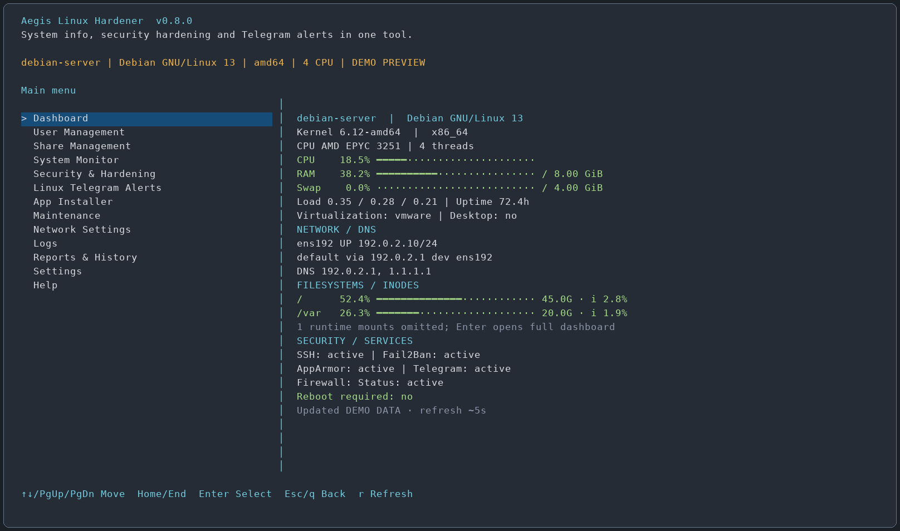
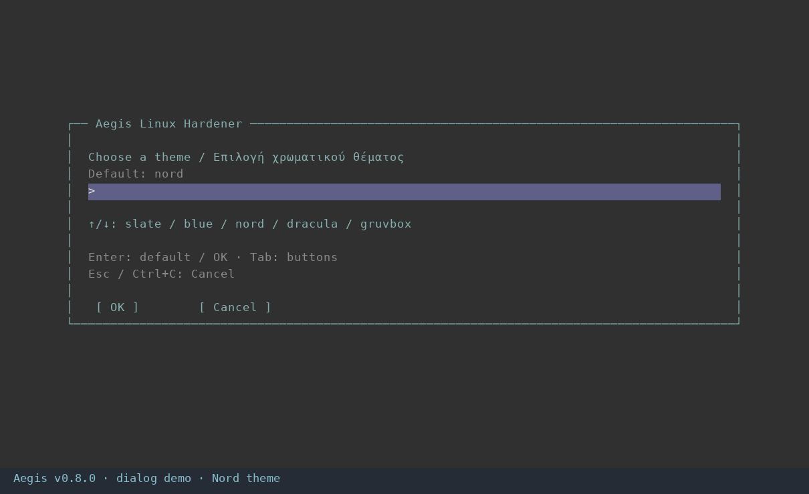
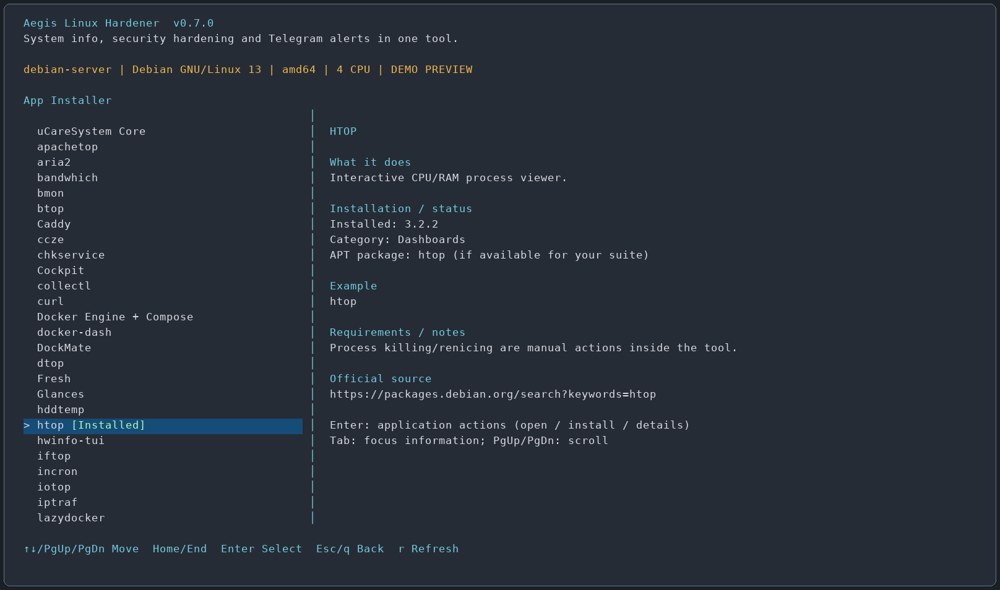

# Aegis Linux Hardener

> System info, security hardening and Telegram alerts in one tool.

**Version 0.7.1 — review release for Debian-based servers and desktops.**

Aegis is an SSH-friendly terminal toolkit combining system information, process monitoring, selective security changes, application installation, and **Linux Telegram Alerts**. Servers are the primary target; desktop utilities are available when their prerequisites exist.

[Ελληνικά](README.el.md)



*Preview rendered from the menu drawing code using demo host information. It is not a screenshot of changes applied to a production server.*

## Fixed in 0.7.1 — dialogs closing with “no input”

The live dashboard used a 200 ms curses input timeout. The curses standard screen retained that setting when a new dialog opened, so idle `get_wch()` raised “no input”. This was reproduced before the fix. Each screen now explicitly sets its own input mode: timed polling for the live dashboard, unlimited waiting for static menus, pagers and questions.

A real PTY regression transitions from the live dashboard into a submenu, text question, pager and cancelled question, waiting 800 ms before input on each screen. All four remain open and respond correctly. The prior nine modal PTY checks and 226 automated tests also pass.

Install the corrected ZIP with `sudo bash ./install-aegis.sh --install`. Until updated, the inline-question workaround is `sudo env AEGIS_DIALOGS=0 aegis`. No host settings need to be reset.

## New in 0.7.0 — online update, SSH key management and dialog boxes



### Update from your own website

Open **Settings → Check / install update**. Aegis reads release metadata, shows the running and available versions, then asks before downloading and again before installation. Enter/y approves; Esc/Cancel returns. It checks SHA-256 and the release marker before executing the downloaded installer. Downgrades and same-version reinstallation are refused by this updater. The installer keeps a program backup/undo record and preserves existing configuration/history. After a successful update Aegis exits; run `aegis` again to load the new code. For same-version repair, use `install-aegis.sh --install` directly.

Publish these **three files from the same release ZIP** at `https://karanik.gr/scripts/linux/aegis-linux-hardener/`:

| File | Purpose |
| --- | --- |
| `install-aegis.sh` | Complete self-contained installer; initial install and update |
| `update-aegis.sh` | Optional standalone update entry point |
| `release.json` | Required version, installer URL and SHA-256 for the menu/updater |

1. Extract the ZIP on your workstation.
2. Upload `install-aegis.sh` and `update-aegis.sh` into that public website directory.
3. Upload `release.json` **last**. Keep all three files from one ZIP together; do not edit the installer after generating metadata.
4. Ensure HTTPS GET requests work without login, redirects, a browser challenge or a WAF block. These are static downloads, not CGI/PHP programs.
5. Test from the server: `curl -fS https://karanik.gr/scripts/linux/aegis-linux-hardener/release.json`.
6. Then use the Settings update item. A 403 indicates denied HTTP access; a 404 indicates a missing file/path. Either stops the update before execution.

Standalone update command, after publishing:

```bash
curl -fSLo update-aegis.sh https://karanik.gr/scripts/linux/aegis-linux-hardener/update-aegis.sh && sudo bash ./update-aegis.sh
```

Initial online installation:

```bash
curl -fSLo install-aegis.sh https://karanik.gr/scripts/linux/aegis-linux-hardener/install-aegis.sh && sudo bash ./install-aegis.sh --install
```

The domain is a trusted code source: HTTPS and a checksum **from that same site** detect transfer/mismatched-file errors, but are not an independent cryptographic release signature. Redirects to another host are refused. No unattended updater, cron entry, repository migration or public listening port is added. Rebuilding modified sources with `python3 build_release.py` regenerates the installer, update helper and matching manifest.

### View and remove SSH public keys

**User Management → View / remove SSH public keys → user → key file** lists fingerprints, key types, comments and whether restrictions are present. Select a key to view its complete public-key row or remove **that row only**. The whole-file view includes comments and unrecognized rows, which are read-only. Only conventional local `~/.ssh/authorized_keys` and `authorized_keys2` are managed; custom AuthorizedKeysFile locations, AuthorizedKeysCommand providers, CA trust and private keys are outside this screen.

Removal defaults to **No**, warns if it is the last recognized key in that file, previews the selected fingerprint and saves a private file backup with metadata. Existing keys, options and comments are preserved. A changed file is rejected rather than overwriting a newer edit. Symlink paths are refused. Over SSH, removal arms the existing timed rollback and requires confirmation from a new SSH connection; keep the current session open. Removing a key does not disconnect existing sessions and does not revoke another copy of the same key elsewhere. Restore through **Reports & History → Undo actions / backups** if needed.

### Dialog controls

Questions use a centered box with a theme-colored input row and **OK / Cancel** buttons. Type normally, use ↑/↓ for listed choices, Enter for the default/selection, Tab or Shift+Tab to focus buttons, and ←/→ to switch buttons. Esc/Ctrl+C cancels and returns to the parent menu. Secrets are masked. Aegis-launched Telegram setup uses the same dialogs and theme. Terminal state is restored on return/cancellation.

At least 32 columns × 15 rows is needed for dialogs; resize if prompted. For old terminals or troubleshooting, start with `AEGIS_DIALOGS=0 aegis` (or `sudo env AEGIS_DIALOGS=0 aegis`) to use the previous inline questions. Standalone Telegram collector/installer remains usable without importing Aegis.

Validation for this release: **226 automated tests** and **9 real PTY modal checks**, including Cancel, secret masking, terminal restoration and network-wizard cancellation. The original live dashboard/page-navigation PTY check also passed. Tests exercise update verification/publication with mocked network/system execution; no production update, SSH key removal or website upload was performed. A live request to release.json returned HTTP 403 during preparation, so the hosted path still needs publication/access verification.

## New in 0.6.0 — navigation, themes and application categories

- Names now read `iftop [Installed]`. The status badge uses the selected theme's status color, including on the highlighted row. The details panel shows the detected version.
- App Installer opens categories, with an **All apps** view. The catalog contains 59 entries; uCareSystem stays first in All apps. Empty categories show a zero count and contain no invented applications.
- Themes: `slate`, `blue`, `nord`, `dracula`, `gruvbox`, `solarized`, `forest`, `amber`, `light`, `plain`. Plain disables color.
- Choice questions accept **Up/Down**, typed values and **Enter** for the default/selected value. Free-text fields support typing and Up to edit the default.
- **Esc**, **Ctrl+C**, `q` or `/back` cancel a question and return to its parent menu. Secret prompts use Ctrl+C. Ctrl+C inside a submenu returns; at the main menu it exits. Cancelling an already-running system action may leave completed steps: review Reports & History and its backup/undo record.
- **Network Settings → Change hostname** validates the name, previews the action and optionally updates the local `127.0.1.1` hosts mapping. It backs up `/etc/hostname`, `/etc/hosts` when edited, and the runtime hostname for undo. It does not rename external DNS records, certificates or application identities. Reopen the shell to refresh an old shell prompt.

### Installation availability and netscanner

The catalog reports its method: APT, vendor, upstream binary, source build, **Guide only** or **Unavailable**. Missing APT candidates can be checked again with the catalog refresh action. Guide-only/unavailable entries offer details rather than an Install button that cannot complete. Some entries are documentation-only on Linux, including Windows-only psnet; watcher needs an exact project identity.

For netscanner, the older error meant neither a matching APT candidate nor a verified upstream binary was available. Version 0.6.0 adds a real source-build route: review **Build/install from source**, approve with Enter/y, then wait for completion. It needs Internet access, at least 4 GiB free in `/var/tmp`, a regular originating sudo user and build prerequisites shown in the plan. Compilation can take several minutes. APT prerequisites are installed only after approval. Source and rustup-init downloads are checksum-verified; Cargo uses the source lockfile. Compilation runs as the regular user, with a temporary Rust toolchain that does not replace system Rust. Successful output is installed as `/usr/local/bin/netscanner` with mode 0755, without SUID or added capabilities. A receipt records source/version/binary hashes; the app can then be opened or removed from its action menu.

Removal is offered for supported APT packages and known root-owned standalone executables. External/user-managed installs may need their original package manager; Aegis explains the restriction. Backups cover managed files and metadata. Package undo depends on old package availability and cannot reverse every package script, downloaded dependency, user-data change or external side effect.

Validation: **208 local automated tests**, **7 real PTY input/cancellation checks**, and a successful isolated netscanner **0.6.43** compilation. See [build evidence](docs/netscanner-build-verification.md). No production hostname, networking, account database or package configuration was changed during these checks. Root publication and package installation still require testing on a disposable Debian/Ubuntu VM with console access. Help reads this README from the installed release.

## New in 0.5.0 — accounts, shares, DNS and application removal

Network Settings now includes **DNS Settings** and **Edit /etc/hosts**. The main menu adds **User Management** and **Share Management**. System Monitor includes **Monitoring applications**, with 28 relevant CPU/RAM, disk, network and Docker tools from the same catalog. App Installer offers **Uninstall (keep data/config)** for installed applications. Samba is also in the catalog: **59 entries** in total.

### DNS without changing the address

1. Network Settings → DNS Settings → Current DNS / resolver shows the current file and resolved information.
2. Select Edit DNS only, then the interface.
3. Choose manual DNS IPs (IPv4/IPv6) or automatic DNS where the current DHCP integration supports it.
4. Enter nameservers separated by spaces/commas. Search domains `-` retains the current list; empty clears it.
5. Review the plan and confirm Enter/y. It edits only DNS-related options in supported existing Netplan, NetworkManager, ifupdown/resolvconf or networkd/resolved configurations. A genuinely unmanaged regular resolv.conf can be edited as a fallback; owned/symlink/ambiguous resolver files are refused.
6. Use a new SSH session and the printed confirmation command within 180 seconds. Also test DNS resolution before keeping the change. Configured addresses, gateways and routes are preserved; manager reload/apply can still briefly affect connectivity, and Netplan can reconfigure other links.

The wizard does not migrate network managers, start a different resolver or disable IPv6. Unsupported/custom ownership needs manual review. Automatic DNS is unavailable for static configurations without an existing DHCP DNS source.

### Edit the hosts file

Network Settings → Edit /etc/hosts → View/Add/Edit/Delete. A row contains an IPv4/IPv6 address, hostname/aliases and an optional comment. Select an existing row to edit/remove it. Other entries/comments are preserved and stale selections are rejected. Core localhost/loopback/host-identity rows are protected. These are local name overrides, not DNS server records; there is no network daemon restart.

### Local users, groups and SSH public keys

User Management includes local account/group lists, account creation, Linux password change, password lock/unlock, account expiry enable/disable, shell choice, deletion, supplementary memberships (including sudo), group creation/deletion, public-key addition, sessions and scoped file permissions.

- Local regular-account operations use UID 1000–59999. System/LDAP/domain accounts are not edited as ordinary users. The currently used management account cannot be deleted/disabled/password-locked or have management access removed through this menu.
- New accounts get a private group and a home using distribution defaults, with the password locked until Set Linux password is used. Password entry is handled by passwd, never argv/history.
- Password lock is not a full account disable: SSH keys and existing sessions may remain usable. Account expiry affects future logins under the configured PAM/SSH policy; sessions are not forcibly killed.
- Add/remove group membership uses supplementary groups, preserving other groups. sudo and docker membership grant powerful privileges; re-login may be required.
- Deletion refuses active processes and never uses userdel -r. Home/mail/shared files are kept. Account Undo does not recursively delete data and can leave files owned by an orphan UID after undoing account creation.
- SSH keys are appended only after public-key format validation; existing authorized_keys is backed up. Verify a second SSH session before changing authentication policy. Private keys never belong in this prompt.

Recovery snapshots contain only the selected local account/group records (including private password hashes and subordinate-ID ranges). Undo compares the recorded post-change state before restoring, preserves unrelated newer users/groups, refuses conflicting records/UID/GID reuse, and uses account database locks. Restore newer changes first. Password hashes are sensitive: snapshots are root-only and not encrypted backup archives; never publish them.

### Ownership, mode and POSIX ACL

User Management → Permissions / POSIX ACL, or Share Management → Unix permissions / POSIX ACL:

1. Enter one existing regular file/directory under /home, /srv, /mnt, /media or /opt. Symlink targets and system-root paths are excluded.
2. Inspect owner/group, octal mode and getfacl output.
3. Choose normal chmod bits (optionally setgid), owner/group, or a named user/group ACL entry.
4. For directory defaults, choose Default ACL explicitly; those entries affect newly created children, not existing descendants.
5. Review and apply. The selected object is changed **nonrecursively**. Mode, UID/GID and the exact POSIX ACL/mask/default ACL are captured for Undo.

ACL tools are offered on demand. Effective rights depend on the ACL mask; setfacl can recalculate it. A replaced target inode prevents automatic ACL/metadata recovery rather than applying old permissions to a different object. Windows NT/SID ACL editing and arbitrary recursive permission repair are outside this release.

### Samba / SMB server management

Share Management is for **standalone local Samba with tdbsam**, not Active Directory/domain-member administration.

- Install Samba installs samba, smbclient and acl. New server services remain stopped/disabled. Existing Samba configuration is retained and existing external instances are not replaced.
- List configured SMB shares shows both Aegis-managed and external definitions, including inherited read-only/guest values. Connected clients/open files uses smbstatus without disconnecting clients.
- Create/edit/remove applies only to the Aegis-managed include file. Existing external shares remain read-only in the inventory. A selected data directory must already exist; removing a share never deletes its data.
- New managed shares require authenticated Linux users or @groups and explicit trusted IP/subnets. Guest access is disabled. SMB write access is a separate choice from Unix write/traverse permissions. SMB1, global firewall openings and automatic service starts are not added.
- Samba passwords are separate from Linux passwords. Add/reset password or enable/disable a local SMB account from Samba accounts. Only basic credential/account flags have scoped recovery; this is not a full SAM/SID/domain-state snapshot.
- testparm validates configuration before application. Active smbd is asked to reload; existing clients may retain settings until reconnecting. Validation does not prove that filesystem permissions or clients will work.
- Service control provides separate start/stop and enable/disable-at-boot operations. Starting uses the existing global bind/interface policy; review LAN/VPN/firewall scope first. Aegis does not open public SMB ports.
- SMB client / mounted shares can install cifs-utils/smbclient and inspect current CIFS mounts. Persistent remote-mount/credential configuration remains a separately reviewed manual task.

### Example: a private team share

1. User Management → Create group → `team`.
2. Create a local regular user, for example `alice`. Add alice to group team using Group membership.
3. Share Management → Create shared data folder → `/srv/team`, group team. The new empty directory is root:team, mode 2770 (setgid).
4. Samba accounts → Add/reset SMB password → alice. This is independent of her Linux login password.
5. Create Samba share → name `team`, path `/srv/team`, valid users `@team`, trusted clients your actual LAN/VPN subnet. Explicitly allow writes if required.
6. Review the testparm-validated plan, then explicitly start smbd. Enable at boot separately if required. Review scoped TCP 445 access in Security → Firewall Manager; no rule is created automatically.
7. On a Windows client in the allowed network, open `\\SERVER_IP\team` and authenticate as alice. Both Samba authorization and Unix/ACL access must permit the operation.

Use Permissions / POSIX ACL to grant any additional per-user/group access or default inheritance. Undo of folder creation uses rmdir only: a nonempty folder is retained and recovery reports that attention is needed, never recursively deleting the files.

### Monitoring tools: install here, open here

System Monitor → Monitoring applications lists 28 applicable catalog tools, with installed markers or **[install + open]**. Select an absent tool, accept the dependency installation plan, and Aegis rechecks/opens it in the same flow. Capture tools still ask for an interface, and Apachetop/Termshark require an existing log/PCAP. Unsupported architecture/source-only tools explain their limitation. Catalog installation/uninstallation remains under App Installer.

### Uninstall a selected application

App Installer → installed application → **Uninstall (keep data/config)**. Review the exact package/file paths, then Enter/y.

APT removal is simulated first, without purge or autoremove. Protected system/SSH/Python packages or collateral application removals are refused. Active NetworkManager, running Docker workloads and active Samba-related services block destructive removal until separately stopped/migrated. Docker volumes/images, share folders, home files and application data are retained.

A root-owned regular /usr/local/bin executable can be backed up and removed; known Aegis Python environments are backed up too. Other external/user-managed installs explain that their original installer must be used. Package undo requires exact old versions and safe dependencies; Aegis attempts to retain old .deb files **before removal**.

### What Undo covers

| Change | Recorded/recovered | Practical limit |
| --- | --- | --- |
| DNS / hosts | Managed files and resolver reload; DNS has timed confirmation | Unsupported owner/manager is refused; no full network snapshot. |
| Local users / groups / passwords | Selected records, hashes and subordinate IDs, with post-change conflict checks | Home/data/session history is retained; newer conflicting changes must be undone first. |
| Owner / mode / POSIX ACL | Exact single-object permissions, mask/default ACL and ownership | No recursive tree snapshots; replaced objects need manual review. |
| Samba share definitions | Existing configuration/include and active reload | Client sessions may need reconnect; shared contents are never rolled back. |
| SMB password/account flags | Private selected credential record | Not all SAM/SID/login/domain metadata is restored. |
| New shared folder | Empty directory removal | Nonempty data is retained; rollback is marked incomplete. |
| App uninstall | Known config/files/environment and package version inventory | Old packages/vendor hooks may prevent full undo; use a VM/system snapshot for that guarantee. |

Read-only screens need no rollback. Arbitrary file edits/deletions inside external tools and already sent Telegram files are not undone by these snapshots. New account/ACL recovery actions keep a durable recovery runner for portable use. All changes are reviewed individually; there is no blanket hardening/install/removal action.

## New in 0.4.1 — install missing requirements and continue

Selecting an action now checks known prerequisites before running it. If a required tool/package is missing, Aegis presents its installation plan immediately. **Enter/y installs it**, retains the normal package/configuration backup, rechecks availability, then resumes the original action once. **n skips the original action.** Failed installations or still-missing executables stop that action without a retry loop.

Example: Security & Hardening → Lynis controls → Audit identity / SSH changes. If auditctl/augenrules are absent, Aegis offers auditd installation there, then returns to the selected audit-watch plan. Password quality similarly offers libpam-pwquality before asking minimum length; q cancels that question cleanly. Installation and the subsequent security policy are separate reviewed/backed-up changes.

Covered recipes include auditd, password quality, AIDE, accounting/sysstat/plocate, rsyslog/TLS, common security diagnostics, AppArmor tools, Fail2Ban, UFW, Lynis, network helpers and selected tool launches. Opening Logs can offer ccze immediately; declining keeps plain logs available. Missing btop/ncdu in System Monitor can be installed and opened without visiting another menu.

Package presence does not prove that a kernel capability, initialized database, active service or custom PAM policy is ready. Those checks remain in place: nmtui still needs active NetworkManager, AIDE needs a trusted baseline, and incompatible PAM overrides are not silently rewritten. Existing-server-only Apache controls do not bootstrap a new web server. Unknown third-party requirements are not guessed. Noninteractive CLI calls do not silently start installing software.

## New in 0.4.0

- Installed applications are visibly marked **[Installed]**, with detected versions in their details. Status refreshes after installation, including Network Settings → nmtui. Installed and running are separate states.
- Enter on an application now opens an **actions menu**: install when absent, open/usage instructions when present, details and refresh. The normal flow no longer attempts to reinstall an installed app.
- **ccze** added in alphabetical order: **58 catalog entries**.
- **Logs** is a main-menu section: categories, time window, line limit, ccze `-A` coloring, private UTF-8 export and explicit Telegram file upload.
- **Fail2Ban Manager and Firewall Manager moved inside Security & Hardening.**
- **Help is the final main-menu entry.** It reads the actual packaged English/Greek README, either whole or by section, so documentation and help stay together.

## First use — step by step

### 1. What you need

Use a Debian/Ubuntu-based machine, an SSH account with sudo, and Python 3.9 or later. The tool is mainly for servers; graphical clients require a real desktop. First test security/network changes in a disposable VM with console access.

`SERVER_IP` below means the Linux machine's address. Replace it with your own IP; do not type the placeholder literally. The example Linux username is `karanik`; replace it if yours differs.

### 2. Download and copy the ZIP

Download `aegis-linux-hardener-v0.7.1.zip` to Downloads on your workstation. On Windows, open **PowerShell on your workstation**:

```powershell
scp "$env:USERPROFILE\Downloads\aegis-linux-hardener-v0.7.1.zip" karanik@SERVER_IP:~/
```

This copies the ZIP to the Linux user's home. It does not install anything. If SSH uses a custom port, use `scp -P YOUR_PORT ...` (capital P).

### 3. Connect to Linux and extract

```powershell
ssh karanik@SERVER_IP
```

Run the following **in the Linux terminal**, not Windows PowerShell:

```bash
cd ~
unzip -o aegis-linux-hardener-v0.7.1.zip
cd ~/aegis-linux-hardener
sudo bash ./install-aegis.sh --install
```

If `unzip` is missing, install core prerequisites explicitly:

```bash
sudo apt update
sudo apt install unzip python3 ca-certificates curl
```

`sudo` asks for your Linux password; typed characters may be invisible. Read the installer summary, then press **Enter** or type **y**. Type **n** to cancel. The bootstrap installs the Aegis program/launcher; select other actions from its menus.

### 4. Open it later or use portable mode

```bash
aegis
# Optional: run the entire menu as root (individual changes can also request sudo):
sudo aegis
```

For portable use from the extracted directory:

```bash
bash ./install-aegis.sh --portable
```

Without flags, the installer offers Install/Update or Portable. `--install --no-launch` installs without opening the menu. `--check` checks payload integrity/syntax without installing.

### 5. Understand the menus and keyboard

| Main menu | Start here when you want to… |
| --- | --- |
| Dashboard | Read OS/kernel/CPU/RAM/disks/network/security; summary appears on the right without Enter. |
| System Monitor | Find high CPU/RAM apps, listeners, connections, services and containers. |
| Security & Hardening | Audit and selectively change security; contains Fail2Ban Manager and Firewall Manager. |
| Linux Telegram Alerts | Configure the bot, destination, notification categories and thresholds. |
| App Installer | Install a selected tool, open an installed tool or read its usage. |
| Maintenance | Inspect/refresh updates and choose reviewed package/maintenance actions. |
| Network Settings | Use the existing-manager static IPv4/DHCP wizard or protected nmtui path. |
| Logs | Inspect a selected log category, export its snapshot or send it to Telegram. |
| Reports & History | Export inventory and select a recorded change for Undo. |
| Settings | Change language/theme and inspect version/removal options. |
| Help | Read all this documentation inside the program. |

Up/Down selects a menu item, Enter opens it, q/Esc returns. Page Up/Down jumps a page and Home/End reaches the beginning/end. **Tab** focuses the right information pane; use arrow/page keys to scroll its text, then Tab to return. A wide terminal (100+ columns) shows the sidebar. `r` refreshes; external tools have their own key bindings.

### 6. Install a tool and open it

Example: App Installer → **htop** → **Install application** → read plan → Enter/y. After returning, the entry is marked **[Installed]** and details show its version. Enter on it again → **Open / usage instructions** launches it. Quit htop using its own q/F10 key to return.

The catalog preserves the actual package identity: nmtui belongs to `network-manager`, iptraf uses `iptraf-ng`, Fresh uses `fresh-editor`. Package installation is detected independently of whether a service is active. Use Refresh when software was installed outside Aegis.

Interactive user tools run as the originating regular account, even when Aegis was started with sudo. Selected administration/capture tools need root. Capture tools ask for an interface, tcpdump is limited to 100 packets, and termshark opens an existing PCAP. Webmin/Cockpit provide SSH-tunnel/browser instructions; WinBoat needs a desktop; uCareSystem opens through Maintenance; nmtui uses Network Settings. ngrok/tmate open help rather than publishing/sharing anything automatically.

Edits, deletions or service changes made inside an external application follow that application's behavior. Aegis installation Undo is not an undo system for every action performed later inside mc/editors/chkservice/rcconf.

### 7. Read colored logs

Open **Logs**, then choose **ccze → Install colorizer** if it is absent. Once installed, views automatically use **`ccze -A -o nolookups`**. The A is the Latin capital A; `-A` emits ANSI colors, and disabling lookups helps responsiveness. A missing colorizer gives plain-text output and a clear installation option.

Choose a category, then **View logs**. If `less` is installed, q closes the pager, arrows/Page Up/Down scroll, and Left/Right pans long lines. Logs are snapshots, not a continuous follow stream; choose **Refresh snapshot** for new events.

Available categories: System/journal, Authentication/SSH/sudo, Kernel/hardware, Fail2Ban, Firewall/UFW, APT/dpkg, Apache, Nginx, Caddy, Docker engine, selected Docker container, Telegram alerts, security daemons, selected systemd service and selected file under `/var/log`.

**Time window / line limit** selects current boot, last hour, today, last 24 hours or last 7 days, and 100/200/500/1000/5000 lines per source. Regular files use their final lines rather than journal date filtering. Docker container windows use relative hours; today/boot mean the last 24 hours. Snapshots are bounded to about 2 MiB plus headers. Missing sources return an explanation.

### 8. Export logs

Category → **Export snapshot** → accept or edit the absolute path → Enter/y. Default output is a dated `.log` in the originating user's home. It contains plain UTF-8, not ANSI control codes. Permissions are private (0600), and home exports belong to that user so they can be copied with scp.

If the file already exists, review overwrite confirmation; the previous file is backed up in Aegis history. Export paths are limited to the chosen user's home or Aegis exports directory. Read original logs remain unchanged.

### 9. Send logs to Telegram

First configure **Linux Telegram Alerts → Install / reconfigure**: choose language, server label, bot token, Chat/Channel ID and categories. The bot must be allowed to post in that destination. Topic/thread ID is optional: **0 means no topic**, otherwise use the target forum topic's ID.

Then Logs → category → **Send snapshot to Telegram**. Inspect the exact snapshot in the pager, exit with q, inspect the displayed Chat ID/Topic, and type **y** to send. Enter cancels this external upload by default. The result is a `.log` **document attachment**, reusing the existing bot configuration; no token is printed. The upload uses the Telegram Bot API `sendDocument` method.

Display/export/send use the same snapshot until Refresh is selected. Known bot tokens, common password/API-key patterns and authorization headers are masked before preview; masking is **best effort**, not proof that a log is safe to share. Delivery is immediate and separate from the alert collector queue. Upload failures are not retried automatically; after an ambiguous timeout, inspect Telegram before retrying to avoid duplicates. Aegis Undo cannot recall a delivered Telegram file.

### 10. Network changes and the nmtui installed/running distinction

A machine using ifupdown can have the nmtui package installed while NetworkManager remains inactive. **[Installed] does not mean it owns your current interface.** Aegis does not silently switch managers or remove `/etc/network/interfaces`. Use the Aegis static/DHCP wizard for the current supported backend. The Open nmtui option explains the requirement if NetworkManager is not active.

For the Aegis wizard, keep the original SSH session open, reconnect to the new IP from an independent session and run the printed confirmation command before the 180-second rollback timer expires. Native nmtui uses NetworkManager's own 150-second checkpoint and confirmation instead. See the network section below for limitations.

### 11. Update and undo

For an update, copy/extract the new ZIP with `unzip -o` and run its installer using `--install`. Existing Aegis-managed changes retain history. To restore a reviewed change, use **Reports & History → Undo actions / backups** and select its ID/title. Review package-recovery limits below; a system/VM snapshot is needed for guaranteed whole-machine rollback.

### 12. Put this project on GitHub

Create a GitHub repository, then upload the **contents of the extracted `aegis-linux-hardener` directory**, including `aegis.py`, `aegis/`, tests, docs, both READMEs, build script and installer. Keep the files together; uploading only `aegis.py` loses its modules and Help. Add the ZIP as a Release asset if desired. Choose/add a LICENSE before claiming a licensed open-source release.

For your download host, upload the **complete generated `install-aegis.sh`** to the proposed URL documented below. These instructions prepare the files; this release has not created/pushed a public repository or uploaded anything to karanik.gr. Never publish real bot tokens, client configuration, production backups or exported logs in GitHub.

## New in 0.3.0

- **Immediate dashboard sidebar:** highlighting Dashboard shows the host overview without Enter. Background collection, approximately five-second refresh, colored CPU/RAM/swap/filesystem meters, network/DNS and service status. Runtime pseudo-mounts are summarized; Enter still opens every mount in the full report.
- **Application information sidebar:** purpose, installed status, examples, prerequisites, source and caveats for all **58 catalog entries**. uCareSystem remains pinned first, all remaining applications are sorted alphabetically by project key.
- **Tab** switches keyboard focus to the information pane. Up/Down and Page Up/Down scroll it; Tab returns to the menu. Home/End work in either pane. The sidebar needs at least 100 terminal columns; smaller terminals retain the normal menu/full report.
- **PortSentry, knockd, Shorewall** sections provide inactive installation, status/logs and configuration guidance. There is no automatic blocker, port-knocking SSH policy or Shorewall firewall replacement. Existing installs remain untouched.
- **nmtui** is available in Network Settings and App Installer. Opening it requires active NetworkManager and supported native checkpoints. Aegis saves configuration for Undo, then starts `nmcli device checkpoint --timeout 150 -- nmtui` outside its state lock. NetworkManager handles live-state checkpoint confirmation/recovery. This differs from the Aegis wizard's independent 180-second confirmation flow. Installing nmtui alone does not migrate an existing network backend.



### Catalog installation coverage

Distribution packages are preferred when a matching package candidate exists. The current suite's repositories are used; missing packages produce an explanation instead of importing an obsolete or foreign repository. Explicit aliases include **iptraf → iptraf-ng**, **nmtui → network-manager**, **Fresh → fresh-editor**.

Official Linux release binaries are supported for bandwhich, docker-dash, DockMate, dtop, Fresh, lazyide, lazydocker and microNeo on amd64/arm64. The installer selects a known architecture pattern, verifies published SHA256 where available, reads only the intended regular executable from an archive and validates ELF architecture. A missing checksum is clearly disclosed in the reviewed plan. No upstream shell installer is piped into a root shell. Runtime shared-library requirements still need validation on the target host.

ngrok uses its official standalone Linux download. Installing **ngrok/tmate never starts a tunnel or shared session**. Capture tools are installed without starting captures or granting permanent SUID/capture permissions.

| Entry | Special handling |
| --- | --- |
| psnet | Included with information only: upstream Windows APIs are not supported on Linux. |
| hwinfo-tui | Isolated Python install when compatible. Reads HWiNFO CSV produced on Windows; use lm-sensors for Linux sensor collection. |
| rovr | Isolated Python install when compatible. Current upstream 0.10.3 requires Python >=3.13,<3.15; older system Python is not replaced. |
| netscanner | APT when available; otherwise reviewed isolated source build with a regular user and verified source checksum. |
| PNANA | APT when available; otherwise Guide only. No automatic source installation is claimed. |
| watcher | Information-only pending an exact project URL. No unrelated OpenStack package is substituted. |
| hddtemp / rcconf / rtop | Legacy/suite-dependent packages. Availability is checked against the host's APT metadata. |

For Python tools, dependency installation/build runs under the originating regular user in an isolated environment; the final environment is root-owned. The Python requirement is checked before any package changes. Aegis does not alter the system Python interpreter. Tools installed in this manner use `/opt/aegis-tools/NAME` and `/usr/local/bin/NAME`, both covered by the action snapshot. Later files edited/deleted inside external applications are outside installation undo.

## What is included

| Section | Functions |
| --- | --- |
| Dashboard | OS, kernel, CPU, current CPU use, load, RAM/swap, filesystems, network, DNS, uptime, service/security state |
| System Monitor | Sampled top CPU/RAM processes, listening ports, connections, failed services, containers, optional btop/ncdu |
| Security & Hardening | Security inventory, Lynis integration, individual SSH controls, scoped sysctl baseline, AppArmor profile management, unattended upgrades |
| Network Settings | Guided IPv4 static/DHCP, address/prefix, gateway and DNS; supported existing Netplan, NetworkManager, ifupdown or networkd configurations |
| Security → Fail2Ban Manager | Install, select available jails, whitelist, thresholds, SSH port, jail status, ban/unban |
| Security → Firewall Manager | Inspect UFW/nftables, install UFW, scoped allow rule, protected activation |
| Linux Telegram Alerts | Existing 22-category collector, persistent queue, English/Greek messages, daily summary |
| App Installer | uCareSystem Core **first**, btop, ncdu, Lynis, Docker Engine/Compose, Caddy, Webmin, WinBoat, Cockpit |
| Maintenance | Local update listing, explicit APT refresh/upgrade/cache cleanup, optional uCareSystem execution |
| Reports & History | JSON inventory export, action history, managed-file backups/restore |
| Settings | English/Greek navigation and prompts, Slate, Blue, Nord, Dracula, Gruvbox, Solarized, Forest, Amber, Light and Plain themes, version/removal |

Technical command output and change-plan details remain in English. Telegram message language is configured separately in its own setup. The plain menu is available when curses or terminal capabilities are limited.

## Requirements and support scope

- Debian-based Linux with `apt-get`, `dpkg`, `/proc`, and an active systemd host.
- Python **3.9+**, including standard `ssl`, `sqlite3`, and `fcntl` modules. No pip packages are required.
- Bash for the self-contained installer, trusted CA certificates and HTTPS connectivity for downloads.
- Read-only pages work as a regular user where permissions permit. Changes require root, normally via `sudo`.
- `systemd-run` is mandatory for protected SSH/firewall changes.

Initial compatibility targets are Debian 12/13 and Ubuntu 22.04/24.04/26.04. Other Debian-based distributions can use supported modules if their prerequisites exist; this does not imply vendor support for every application or a tested distribution matrix. Ubuntu 20.04's default Python 3.8 does not meet the requirement. The installer never replaces the system Python.

Official Docker repository setup accepts known Debian base suites and Ubuntu suites/`UBUNTU_CODENAME`. It does not guess a Debian suite for a rolling derivative. Minimal containers without systemd, WSL without a suitable systemd host, and non-Debian package managers are outside the installation scope.

## Quick start — local ZIP

1. Download and copy `aegis-linux-hardener-v0.7.1.zip` to the target machine. Example from Windows PowerShell:

```powershell
# Replace SERVER_IP with the target address.
scp "$env:USERPROFILE\Downloads\aegis-linux-hardener-v0.7.1.zip" karanik@SERVER_IP:~/
```

2. In the Linux SSH terminal:

```bash
cd ~
unzip -o aegis-linux-hardener-v0.7.1.zip
cd ~/aegis-linux-hardener
sudo bash ./install-aegis.sh --install
```

If core packages are missing on Debian/Ubuntu, install them explicitly first:

```bash
sudo apt update
sudo apt install python3 ca-certificates unzip curl
```

3. Read the installation summary and press **Enter** or type **y**. The bootstrap installs only the Aegis program and launcher, then opens the menu. It does **not** automatically harden SSH, activate a firewall, install apps, or configure Telegram.

4. Use the menu or start it later:

```bash
aegis
```

If already root, omit `sudo`. The shell installer is self-contained, including its Python application payload.

### Portable operation

```bash
bash ./install-aegis.sh --portable
```

Without flags, the installer offers **1 Install/Update** (Enter or y) and **2 Portable**. Installed files go to `/opt/aegis-linux-hardener`, with the `aegis` launcher. The installed directory is readable/executable by regular users (fixes the v0.1.0 permission problem). `--no-launch` installs without opening the menu.

### Future hosted installation

Proposed location — **not published by this release preparation**:

```text
https://karanik.gr/scripts/linux/aegis-linux-hardener/install-aegis.sh
```

After uploading the full generated shell file there:

```bash
curl -fSL https://karanik.gr/scripts/linux/aegis-linux-hardener/install-aegis.sh -o install-aegis.sh && sudo bash ./install-aegis.sh --install
```

The file is downloaded before execution so interactive standard input remains available. Do not pipe the installer into Bash.

### Inspect without installing

```bash
bash ./install-aegis.sh --check
bash ./install-aegis.sh --extract ./aegis-source
```

`--check` verifies the embedded payload hash and compiles the Python source in a temporary directory; it does not apply system configuration. The embedded hash detects corruption, not authenticity if an attacker replaces both code and hash. Obtain releases from a trusted source.

## Terminal controls

| Key | Action |
| --- | --- |
| Up/Down or j/k | Move |
| Enter | Select; on a report, return |
| q / Esc | Back; exit from main menu |
| r | Refresh/reload the displayed page |
| Page Up / Page Down | Move one page in menus and reports |
| Home / End | First / last menu entry or report line |
| Tab | Focus/unfocus the information sidebar; arrow/page keys scroll that pane |

Use a wider terminal for a sidebar/detail layout. Small terminals fall back to a simpler layout/menu. CPU tables use sampled CPU deltas; **100% means one logical CPU**, so a multithreaded process can exceed 100%. RAM values are RSS, not unique/proportional memory. Load average is separate from CPU percentage.

## Read-only command line

```bash
aegis info
aegis info --json
aegis monitor --sort ram
aegis monitor --sort cpu
aegis audit
aegis --basic
aegis --language en
aegis --version
```

`audit` is an inventory, not a compliance certification or invented security score. Optional Lynis provides its own findings when explicitly launched. No process command lines, tokens, or password files are exported in the inventory report.

## How changes work

1. Select a specific operation.
2. Aegis rebuilds a known change plan at the root boundary.
3. Inspect managed file contents, commands, source URLs, and relevant warnings.
4. Press **Enter** or type **y** to proceed, or cancel without applying the plan.
5. Managed files are backed up, validation runs, and the action is recorded.

APT retains its own package/dependency confirmation. Package upgrades, downloaded cache deletion, vendor post-install scripts, group access grants, and other live effects are not equivalent to a VM snapshot. Package undo is conditional: new packages can be removed and previous versions restored only when dependencies permit and exact old packages are retrievable. Vendor side effects are not fully reversible.

### Protected SSH and firewall changes

Before modifying SSH/UFW, Aegis arms a systemd rollback timer for approximately **180 seconds**. After applying:

1. Keep the original connection open.
2. Open a **new independent SSH connection**, verify access and relevant application behavior.
3. Run the exact command printed by Aegis:

```bash
sudo aegis confirm CHANGE_ID
```

4. Press **Enter** or type **y** to cancel automatic rollback. The same SSH connection that applied the change is rejected for confirmation. SSH connection multiplexing can reuse the original connection; disable multiplexing if necessary.

Without confirmation, the stored managed files/settings are restored. A local-console operation can be confirmed locally. If SSH connection identity is lost through environment filtering, Aegis refuses confirmation rather than silently treating it as a verified second SSH session.

Manual restore:

```bash
sudo aegis rollback CHANGE_ID
```

Press **Enter** or type **y** after reviewing the target change. Review change IDs/status under **Reports & History**. Resolve a pending protected change before applying another plan or upgrading Aegis.

The rollback timer is a transient systemd timer; rebooting the host before confirmation can interrupt that timer. Do not reboot while a change is pending. Files/settings restore is best effort and is not a replacement for console access or a VM snapshot. Failed restores are recorded as requiring attention.

### Network Settings

Select an interface, then static IPv4 or DHCP, address/prefix, gateway and DNS. Aegis detects the existing configuration manager and preserves IPv6 and unrelated interfaces. Complex routes, bridges/bonds/VLANs, unsupported ownership and custom hooks are refused with an explanation. Netplan requires the distribution `python3-yaml` package. NetworkManager private keyfile contents are hidden in the plan.

Activation runs in an independent systemd worker, so losing the originating SSH connection does not kill activation or rollback. After reconnecting to the new address, use the displayed confirmation command. Portable runs retain a private recovery copy outside the temporary extraction folder. Netplan apply can reconfigure other links; use console access for initial validation. This wizard does not manage every possible Linux network configuration.

### Lynis findings and selected remediation

The supplied audit reported index **68**, one warning and 53 suggestions, representing **39 distinct control IDs**. All are mapped to an action, inspection or manual review in **Security & Hardening → Lynis**; this does not mean all findings are automatically fixed. See [the complete review](docs/lynis-review.md).

Added controls include PAM password quality, account aging/defaults, auditd watches, AIDE baseline, logging, accounting/sysstat, selected permissions, optional unused module restrictions, service sandboxing and extra SSH/sysctl settings. Each change is selected and reviewed separately. Apache WAF starts in DetectionOnly. The repository audit flags obvious Ubuntu PPA entries on Debian without deleting them.

### Backup and undo coverage

**Reports & History → Undo** lists changes. Managed files, permissions/ownership, selected service state, program installation/removal and Telegram configuration/program changes retain recovery data. The live Telegram delivery queue is retained rather than rewound. Configuration secrets in private backups remain root-only.

APT actions record package versions/manual marks and try to retain exact previous `.deb` files. Undo refuses unsafe dependency removals or unavailable old versions, with a configuration-only fallback. Arbitrary vendor scripts, remote effects and all package/cache side effects cannot be guaranteed reversible. Use a system/VM snapshot for complete recovery. Read-only pages need no undo.

### SSH controls

Independently selectable:

- Root password login disabled while root public-key login remains available.
- Public-key-only login, after a valid authorized_keys file and a verified second-session key login.
- Authentication limits: `MaxAuthTries=3`, `LoginGraceTime=30`.

Aegis manages its own drop-in, validates syntax, and checks effective settings for the selected account/source before reload. Existing conflicting rules prevent application and trigger file restoration. Keys-only mode disables keyboard-interactive authentication; incompatible existing MFA/AuthenticationMethods requires manual review. Other users, custom authorized-key mechanisms and complex Match rules still need administrator review.

### Fail2Ban

Install first, then select available filters/jails. Configure trusted IPs/networks, max retries, findtime, bantime, and the **actual SSH port**. Existing actions and jails configured elsewhere are inherited/preserved. Selecting a jail requires real logs; `fail2ban-client -t` must pass before restart. Detection of a filter file alone is not proof that an application is protected.

### Firewall

UFW is configured explicitly; existing rules/policies are not reset. An active firewalld service prevents UFW management. Independently detected nftables rules can require manual review. The tool does not implement a general-purpose nftables ruleset editor.

**Docker published ports can bypass host UFW rules.** This release shows that limitation and does not claim to secure container exposure with a host allow rule. It does not rewrite Docker's generated rules, disable forwarding, or automatically configure container filtering.

### AppArmor and kernel baseline

AppArmor status is inspected separately from per-profile `complain`/`enforce` actions. Aegis does not enforce all profiles at once. Test application behavior before retaining stricter confinement.

The scoped sysctl baseline changes only kernel pointer/log visibility and protected hardlink/symlink controls. It does not disable routing, Docker forwarding, IPv6, or swap.

## Application catalog

| App | Source / behavior |
| --- | --- |
| uCareSystem Core | First catalog entry; matching upstream GitHub release `.deb`. Package hooks can add the Utappia repository/key; upstream describes Debian support as partial. Running maintenance is a separate action. |
| btop, ncdu, Lynis | Distribution's configured APT repositories. ncdu is launched read-only from the monitor menu. |
| Docker Engine + Compose | Official Docker APT key/source and packages. Existing runtimes/conflicting packages are not automatically removed. No user is automatically added to the docker group. |
| Caddy | Official stable Cloudsmith APT source. A new Caddyfile serves only `http://127.0.0.1:8080`. Existing configuration is refused by the fresh-install flow. |
| Webmin | Official signed APT source. A new service binds to `127.0.0.1:10000`; no firewall port is opened. Existing configuration is refused by the fresh-install flow. |
| WinBoat | Upstream amd64 `.deb` only after desktop/KVM/resource/container/FreeRDP preflight. Client installation only; no Windows guest is created or launched. |
| Cockpit | Distribution APT package with a socket drop-in for `127.0.0.1:9090`; no firewall port is opened. |

For new network services, package service startup is suppressed until local configuration is written. An existing administrator `policy-rc.d` is respected by refusing this managed install path; Aegis does not replace that policy.

If an Aegis package action is forcibly interrupted, its marked temporary service-start guard can remain. After verifying no package operation is still running, use **Maintenance → Repair stale package startup guard**. It requires Enter/y confirmation and refuses unrelated administrator policies. Package/dpkg recovery is separate.

Installed catalog applications offer Open and Uninstall actions. Reinstallation is avoided; use explicit Maintenance for upgrades. Catalog availability depends on distribution suite, architecture, vendor assets and network access. Missing optional tools return an explanation to the menu; core requirement failures still prevent operations that cannot work.

### Access Webmin/Cockpit through SSH

```bash
# Run from your workstation.
ssh -L 10000:127.0.0.1:10000 USER@SERVER
ssh -L 9090:127.0.0.1:9090 USER@SERVER
```

Then open `https://127.0.0.1:10000` or `https://127.0.0.1:9090`. Self-signed HTTPS certificates may require local browser trust handling. These installs do not add public reverse-proxy routes.

### WinBoat specifics

A desktop, KVM, sufficient RAM/CPU/storage, supported container runtime/Compose and FreeRDP 3 are required. The UI checks common prerequisites; sound-enabled FreeRDP build features, KVM user permissions and the final Windows setup still need validation in the actual desktop session. WinBoat is an upstream beta application.

Docker group access is offered as a separate explicit action because it grants root-equivalent host access. Re-login is needed after group changes. FreeRDP 3 may not exist in older distribution repositories; Aegis does not replace distribution packages with an arbitrary third-party build.

## Linux Telegram Alerts

The existing `linux-telegram-alerts` identity is retained to avoid a duplicate collector/timer. Existing version 1.x configuration, token, destination and queue are reused when setup is run. Alerts are not installed automatically by the Aegis bootstrap.

Configure language, server label, hidden token, Chat/Channel ID, optional Topic ID, categories and thresholds from its own menu. Missing optional commands/certificate paths are skipped with a clear explanation.

```bash
sudo linux-telegram-alerts status
sudo linux-telegram-alerts test
sudo linux-telegram-alerts configure
sudo journalctl -u linux-telegram-alerts.service -n 30 --no-pager
```

Includes boot, SSH, sudo failures, bans/unbans, service failures/recovery, RAM/swap/load, disk/inodes, OOM/kernel, IPv4 changes, Docker, PEM expiry, Certbot, MD RAID, file changes, daily health and custom events.

```bash
printf '%s\n' '✅ Backup completed' | sudo linux-telegram-alerts enqueue
```

Token storage is root-readable plaintext with restrictive permissions, not an encrypted vault. Delivery is at least once, with persistent retries; duplicate messages can occur after an ambiguous API timeout. Powered-off/disconnected hosts cannot send immediately. Polling can miss brief transitions, and log recovery depends on journal/log retention.

Separate old `tena-alerts.timer` / `telegram-notifications.timer` installations require manual migration; Aegis does not overwrite those deployments.

## Files, privacy and removal

| Location | Purpose |
| --- | --- |
| `/opt/aegis-linux-hardener` | Aegis source/application |
| `/usr/local/bin/aegis` | Launcher |
| `/etc/aegis-linux-hardener/ui.json` | Shared UI preferences when configured as root; no secrets |
| `~/.config/aegis-linux-hardener/ui.json` | Per-user UI preferences |
| `/var/lib/aegis-linux-hardener/backups` | Private change manifests and managed-file copies |
| `/var/lib/aegis-linux-hardener/history.jsonl` | Action IDs, titles, timestamps and outcomes |
| `/var/backups/aegis-linux-hardener-*` | Previous program versions saved by the bootstrap |

Aegis has no telemetry or inbound remote-command service. Selected app installation contacts package/vendor repositories; Telegram delivery contacts Telegram. Inventory exports contain host/network details, so share them intentionally.

To remove Aegis:

```bash
sudo aegis uninstall
```

Confirm with Enter/y. Program files and launcher are removed. Recovery data/preferences and the independent Telegram collector remain. To remove that collector, run its own uninstall action separately.

## Development and verification

```bash
python3 -m unittest discover -s tests -v
python3 -m compileall -q aegis aegis.py
python3 aegis.py info --json
python3 aegis.py monitor --sort cpu
bash install-aegis.sh --check
```

Version 0.6.0 passed **208 local tests**, including the 29 prior Telegram tests. New cases cover cancellation, file/mode restoration, validation failure, timer ordering, second-session confirmation, pending-change exclusion, service-start suppression, input validation, app prerequisites, digest rejection and archive path safety. Live read-only collectors and a real pseudo-terminal menu were also exercised in the build environment.

APT operations, SSH reloads, firewall changes, package service hooks, vendor downloads and rollback timers were tested through mocks, **not on production machines or a full Debian/Ubuntu VM matrix**. Treat this as a review release: verify changes on a disposable VM with console access before production use. Network manager fixtures, detached activation, portable recovery, installer permissions and package undo safeguards are also covered; live network changes remain untested on a full VM.

## Repository and release layout

Keep `aegis.py`, `aegis/`, `tests/`, `install_stage.py`, `build_release.py`, both README files and `docs/` together. The generated `install-aegis.sh` is a standalone distribution artifact. `build_release.py` rebuilds its embedded payload and checksum files; it excludes the generated installer to avoid recursion.

```bash
python3 build_release.py
```

No public GitHub repository or hosted installer has been created by preparing these files. A project license has not been selected; choose/add a LICENSE before presenting the repository as licensed open source. Downloaded applications retain their own upstream licenses.

The additional tests cover all requested app identities/order, package aliases, unsupported-platform guards, single-query inventory, architecture/checksum/path/link safeguards, Python version requirements, inactive defense installs and pure dashboard formatting. A real PTY check also exercised live overview without Enter, menu paging and independent information-pane scrolling. No package install, daemon activation, packet scan, tunnel or production firewall/network change was performed in this build environment.

The UI drawing implementation is original; [ServerHub](https://github.com/nickprotop/ServerHub) was used as a visual reference, not as a copied code dependency. The [awesome-tuis](https://github.com/rothgar/awesome-tuis) list supplied discovery links; exact upstream projects determine platform/install support.

The 0.4 tests also exercise installed-vs-open menu behavior, Network Settings detection refresh, hierarchy/Help content, log query validation, ANSI/secret masking, file containment, private export ownership, exact multipart snapshot/topic handling and sanitized upload failures. Telegram upload and external app execution are mocked; no real messages or external tools were launched by the tests.

## Official references

- [uCareSystem](https://github.com/Utappia/uCareSystem)
- [Docker Engine — Debian](https://docs.docker.com/engine/install/debian/)
- [Docker Engine — Ubuntu](https://docs.docker.com/engine/install/ubuntu/)
- [Docker firewall behavior](https://docs.docker.com/engine/network/packet-filtering-firewalls/)
- [Caddy installation](https://caddyserver.com/docs/install)
- [Webmin installation](https://webmin.com/download/)
- [WinBoat](https://www.winboat.app/)
- [Cockpit](https://cockpit-project.org/running.html)
- [Fail2Ban](https://github.com/fail2ban/fail2ban)
- [Ubuntu AppArmor](https://documentation.ubuntu.com/server/how-to/security/apparmor/)
- [Lynis](https://github.com/CISOfy/lynis)
- [Telegram Bot API](https://core.telegram.org/bots/api)

- [Debian ccze manual](https://manpages.debian.org/bookworm/ccze/ccze.1.en.html)
- [Telegram sendDocument](https://core.telegram.org/bots/api#senddocument)

## v0.5 verification scope

208 local automated tests include DNS-only preservation, hosts validation, scoped account recovery/conflicts, database locking, ACL/metadata recovery, share authorization and safe uninstall guards. Real PTY navigation was also checked. No real account database, Samba service, production network, package removal or remote file share was changed. Validate these modules on a disposable Debian/Ubuntu VM with console access before production use.

Primary references: [usermod](https://manpages.debian.org/bookworm/passwd/usermod.8.en.html), [setfacl](https://manpages.debian.org/bookworm/acl/setfacl.1.en.html), [testparm](https://manpages.debian.org/bookworm/samba-common-bin/testparm.1.en.html), [smb.conf](https://manpages.debian.org/bookworm/samba-common-bin/smb.conf.5.en.html), [pdbedit](https://manpages.debian.org/bookworm/samba/pdbedit.8.en.html).
